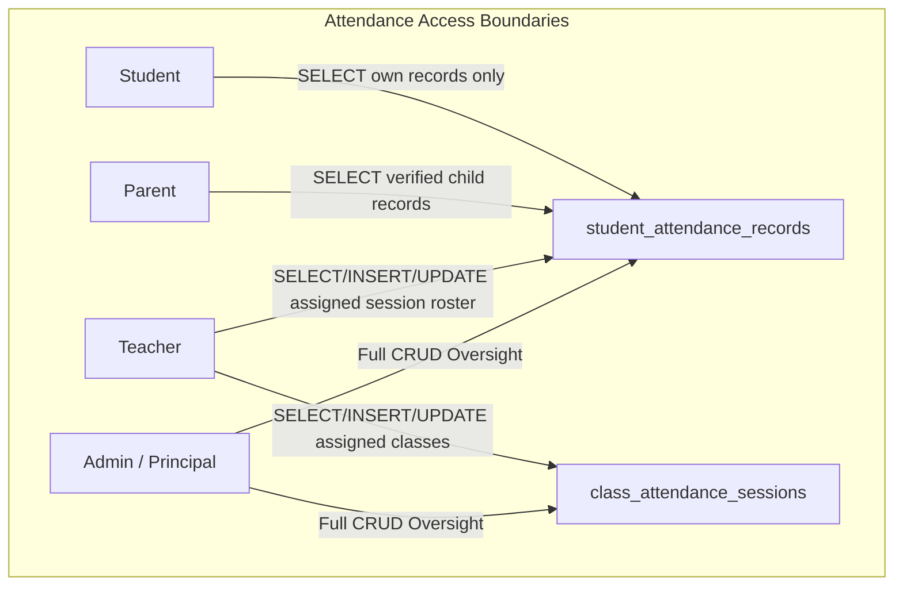

# Corrected Stage 4: RLS Hardening & Storage Security Review

> **Document Version:** 1.1.0 (Phase 1.1 SQL Defect Remediation)  
> **Deployment Architecture:** Single-Institution Dedicated Deployment  
> **Script Name:** `028_stage4_rls.sql`  
> **Target Database:** PostgreSQL 15+ (Supabase Managed Instance: `ogbbyqxulhegwvrtinib.supabase.co`)  
> **Execution Status:** Static Engineering Specification (Zero Execution)

---

## 1. Executive Summary

Stage 4 establishes zero-trust data access control across the PostgreSQL engine and Supabase storage layers. This review resolves the major security vulnerabilities identified during the Phase 1.1 audit:
1. **`DEF-007` (Permissive RLS Overlaps):** The live database contains multiple overlapping permissive policies evaluating to `true` (e.g. `Allow read hall tickets` and `Allow manage hall tickets` on `hall_tickets`, `fee_structures_public_read`, `broadcasts_public_read`). Stage 4 executes a comprehensive drop across all 23 legacy permissive policies before creating restricted policies.
2. **`DEF-008` (Attendance Records Application Lockout):** Stage 4 provides complete, granular role-based policies for `student_attendance_records` (covering SELECT, INSERT, UPDATE, and DELETE), preventing the catastrophic lockout that dropping `att_records_all` alone would have caused.
3. **`DEF-009` (Storage Path Traversal & Deletion):** Hardens `storage.objects` policies across all buckets (`documents`, `student_documents`, `staff_documents`, `attachments`), enforcing strict folder-prefix isolation (`(storage.foldername(name))[1] = auth.uid()::text`).

---

## 2. The PostgreSQL Permissive Combination Rule & Dropping Inventory

In PostgreSQL:
$$\text{Effective Access} = \bigvee_{i=1}^n \text{Permissive Policy}_i$$
If even one legacy policy with `USING (true)` remains attached to a table, any new restricted policy is completely bypassed.

### 2.1 Complete Inventory of Dropped Legacy Policies

| Target Table / Schema | Dropped Policy Name | Live Access Granted | Business / Security Reason for Dropping |
| :--- | :--- | :--- | :--- |
| `public.class_attendance_sessions` | `att_sessions_all` | `ALL TO authenticated (true)` | Unrestricted session tampering across classes. |
| `public.student_attendance_records` | `att_records_all` | `ALL TO authenticated (true)` | Unrestricted roll call and mark modification. |
| `public.staff_leave_balances` | `staff_leaves_bal_all` | `ALL TO authenticated (true)` | Unrestricted staff leave quota modifications. |
| `public.staff_leave_applications`| `staff_leaves_app_all` | `ALL TO authenticated (true)` | Unauthorized leave self-approvals. |
| `public.staff_payroll_runs` | `payroll_runs_all` | `ALL TO authenticated (true)` | Unrestricted payroll generation and disbursement. |
| `public.staff_payroll_items` | `payroll_items_all` | `ALL TO authenticated (true)` | Exposure of all employee salary slips to any user. |
| `public.hall_tickets` | `hall_tickets_all` | `ALL TO authenticated (true)` | Exam clearance bypass. |
| `public.hall_tickets` | `Allow manage hall tickets` | `ALL TO authenticated (true)` | **DEF-007:** Overlapping permissive policy granting universal write. |
| `public.hall_tickets` | `Allow read hall tickets` | `SELECT TO public (true)` | **DEF-007:** Public leak of student register numbers and exam centers. |
| `public.fee_structures` | `fee_structures_all` | `ALL TO authenticated (true)` | Unauthorized fee structure tampering. |
| `public.fee_structures` | `fee_structures_public_read`| `SELECT TO public (true)` | **DEF-007:** Unrestricted public scraping. |
| `public.fee_payment_reminders` | `fee_reminders_all` | `ALL TO authenticated (true)` | Unauthorized reminder dispatch. |
| `public.fee_receipts` | `fee_receipts_all` | `ALL TO authenticated (true)` | Financial receipt spoofing. |
| `public.scholarship_applications`| `scholarship_apps_all`| `ALL TO authenticated (true)` | Unauthorized scholarship awards. |
| `public.library_circulation` | `library_circ_all` | `ALL TO authenticated (true)` | Library book theft and return manipulation. |
| `public.hostel_rooms` | `hostel_rooms_all` | `ALL TO authenticated (true)` | Unauthorized room allocation. |
| `public.hostel_out_passes` | `hostel_out_passes_all` | `ALL TO authenticated (true)` | Unauthorized student departure passes. |
| `public.placement_drives` | `placement_drives_all` | `ALL TO authenticated (true)` | Unauthorized recruitment drive postings. |
| `public.placement_applications` | `placement_apps_all` | `ALL TO authenticated (true)` | Unauthorized candidate selections. |
| `public.institutional_broadcasts`| `broadcasts_all` | `ALL TO authenticated (true)` | Unauthorized institutional announcement broadcasting. |
| `public.institutional_broadcasts`| `broadcasts_public_read`| `SELECT TO public (true)` | **DEF-007:** Overlapping unauthenticated read. |
| `storage.objects` | `Authenticated users can delete documents` | `DELETE TO authenticated (documents)` | **DEF-009:** Arbitrary file deletion across institution. |
| `storage.objects` | `Authenticated users can upload documents` | `INSERT TO authenticated (documents)` | **DEF-009:** Arbitrary file overwrite and path spoofing. |

---

## 3. Granular Role-Based Replacement Policies

### 3.1 Attendance System Policies (`DEF-008`)



#### Attendance Sessions:
- **`att_sessions_select`:** Permitted for leadership (`admin`, `principal`, `hod`, `coe`), the teacher who conducted the session, students enrolled in that class, and verified parents of enrolled students.
- **`att_sessions_insert`:** Permitted for `admin`, `principal`, or the assigned teacher.
- **`att_sessions_modify`:** Permitted for `admin`, `principal`, or the teacher within a strict 24-hour correction window.
- **`att_sessions_delete`:** Restricted to `admin` and `principal`.

#### Attendance Records (`DEF-008`):
- **`att_records_select`:**
  - Student: `student_id = auth.uid()`
  - Parent: `public.is_parent_of(student_id)`
  - Teacher: Session conducted by `teacher_id = auth.uid()`
  - Leadership: `admin`, `principal`, `hod`
- **`att_records_insert`:** `admin`, `principal`, or teacher inserting roster records for their own session.
- **`att_records_modify`:** `admin`, `principal`, or teacher within 24 hours.
- **`att_records_delete`:** `admin`, `principal`.

---

### 3.2 Staff Payroll & Leave Systems
- **`staff_payroll_runs`:** Restricted to `admin`, `principal`, `finance_manager`, `accountant`, and `hr_manager` for view; management restricted to leadership and finance manager.
- **`staff_payroll_items`:** Individual employees can view their own payslips (`user_id = auth.uid()`); finance and HR have administrative access.
- **`staff_leave_balances`:** Individual employees can view their own quotas (`user_id = auth.uid()`); HR and leadership manage records.
- **`staff_leave_applications`:** Employees create and view their own applications; HR and leadership review and approve.

---

### 3.3 Examination & Hall Tickets (`DEF-007`)
- **`hall_tickets_select`:** Student views their own hall ticket (`student_id = auth.uid()`); verified parent views their child's ticket; COE, principal, and admin have full institutional oversight.
- **`hall_tickets_manage`:** Restricted strictly to `admin`, `principal`, and `coe`.

---

## 4. Storage Security Hardening (`storage.objects`, `DEF-009`)

### 4.1 Root Cause of Storage Vulnerabilities
Under the live policy, an attacker authenticating as a student could issue a PostgREST call to upload an object to `documents/admin_signatures/chancellor_sig.png` or delete any official document.

### 4.2 Folder-Prefix Ownership Policy
In Supabase storage, the helper function `storage.foldername(name)` splits the object path into an array of directory segments.
Enforcing `(storage.foldername(name))[1] = auth.uid()::text` guarantees:
1. Every non-administrative user is confined to their own directory root matching their verified UUID.
2. An ordinary user cannot create, overwrite, modify, or delete files inside another user's directory.
3. Institutional administrative users (`admin`, `principal`) retain administrative oversight to manage institutional documents in root or shared paths.

---

## 5. Complete Corrected Stage 4 SQL Script

```sql
-- =============================================================================
-- Migration: 028_stage4_rls.sql
-- Description: Zero-Trust RLS Hardening, Overlapping Policy Drops & Storage Security
-- Architecture: Single-Institution Dedicated Deployment
-- Safety Safeguards: Strict lock_timeout and statement_timeout
-- =============================================================================

SET lock_timeout = '3s';
SET statement_timeout = '10s';

BEGIN;

-- =============================================================================
-- 1. DROP ALL 23 LEGACY PERMISSIVE POLICIES (DEF-007, DEF-008, DEF-009)
-- =============================================================================
DROP POLICY IF EXISTS "att_sessions_all" ON public.class_attendance_sessions;
DROP POLICY IF EXISTS "att_records_all" ON public.student_attendance_records;
DROP POLICY IF EXISTS "staff_leaves_bal_all" ON public.staff_leave_balances;
DROP POLICY IF EXISTS "staff_leaves_app_all" ON public.staff_leave_applications;
DROP POLICY IF EXISTS "payroll_runs_all" ON public.staff_payroll_runs;
DROP POLICY IF EXISTS "payroll_items_all" ON public.staff_payroll_items;
DROP POLICY IF EXISTS "hall_tickets_all" ON public.hall_tickets;
DROP POLICY IF EXISTS "Allow manage hall tickets" ON public.hall_tickets;
DROP POLICY IF EXISTS "Allow read hall tickets" ON public.hall_tickets;
DROP POLICY IF EXISTS "fee_structures_all" ON public.fee_structures;
DROP POLICY IF EXISTS "fee_structures_public_read" ON public.fee_structures;
DROP POLICY IF EXISTS "fee_reminders_all" ON public.fee_payment_reminders;
DROP POLICY IF EXISTS "fee_receipts_all" ON public.fee_receipts;
DROP POLICY IF EXISTS "scholarship_apps_all" ON public.scholarship_applications;
DROP POLICY IF EXISTS "library_circ_all" ON public.library_circulation;
DROP POLICY IF EXISTS "hostel_rooms_all" ON public.hostel_rooms;
DROP POLICY IF EXISTS "hostel_out_passes_all" ON public.hostel_out_passes;
DROP POLICY IF EXISTS "placement_drives_all" ON public.placement_drives;
DROP POLICY IF EXISTS "placement_apps_all" ON public.placement_applications;
DROP POLICY IF EXISTS "broadcasts_all" ON public.institutional_broadcasts;
DROP POLICY IF EXISTS "broadcasts_public_read" ON public.institutional_broadcasts;

-- Storage Drops
DROP POLICY IF EXISTS "Authenticated users can delete documents" ON storage.objects;
DROP POLICY IF EXISTS "Authenticated users can upload documents" ON storage.objects;
DROP POLICY IF EXISTS "Strict document delete policy" ON storage.objects;

-- =============================================================================
-- 2. CLASS ATTENDANCE SESSIONS POLICIES
-- =============================================================================
CREATE POLICY "att_sessions_select" ON public.class_attendance_sessions FOR SELECT TO authenticated
USING (
    public.get_current_user_role() IN ('admin', 'principal', 'hod', 'coe')
    OR teacher_id = auth.uid()
    OR EXISTS (
        SELECT 1 FROM public.profiles p 
        WHERE p.id = auth.uid() AND p.class_name = class_attendance_sessions.class_name
    )
    OR EXISTS (
        SELECT 1 FROM public.parent_student_links l 
        JOIN public.profiles child ON child.id = l.student_id 
        WHERE l.parent_id = auth.uid() 
          AND l.verified = true 
          AND child.class_name = class_attendance_sessions.class_name
    )
);

CREATE POLICY "att_sessions_insert" ON public.class_attendance_sessions FOR INSERT TO authenticated
WITH CHECK (
    public.get_current_user_role() IN ('admin', 'principal')
    OR (
        public.get_current_user_role() IN ('teacher', 'hod')
        AND teacher_id = auth.uid()
    )
);

CREATE POLICY "att_sessions_modify" ON public.class_attendance_sessions FOR UPDATE TO authenticated
USING (
    public.get_current_user_role() IN ('admin', 'principal') 
    OR (teacher_id = auth.uid() AND created_at >= (NOW() - INTERVAL '24 hours'))
)
WITH CHECK (
    public.get_current_user_role() IN ('admin', 'principal') 
    OR (teacher_id = auth.uid() AND created_at >= (NOW() - INTERVAL '24 hours'))
);

CREATE POLICY "att_sessions_delete" ON public.class_attendance_sessions FOR DELETE TO authenticated
USING (public.get_current_user_role() IN ('admin', 'principal'));

-- =============================================================================
-- 3. STUDENT ATTENDANCE RECORDS POLICIES (DEF-008)
-- =============================================================================
CREATE POLICY "att_records_select" ON public.student_attendance_records FOR SELECT TO authenticated
USING (
    student_id = auth.uid()
    OR public.is_parent_of(student_id)
    OR public.get_current_user_role() IN ('admin', 'principal', 'hod')
    OR EXISTS (
        SELECT 1 FROM public.class_attendance_sessions s 
        WHERE s.id = student_attendance_records.session_id AND s.teacher_id = auth.uid()
    )
);

CREATE POLICY "att_records_insert" ON public.student_attendance_records FOR INSERT TO authenticated
WITH CHECK (
    public.get_current_user_role() IN ('admin', 'principal')
    OR EXISTS (
        SELECT 1 FROM public.class_attendance_sessions s 
        WHERE s.id = student_attendance_records.session_id AND s.teacher_id = auth.uid()
    )
);

CREATE POLICY "att_records_modify" ON public.student_attendance_records FOR UPDATE TO authenticated
USING (
    public.get_current_user_role() IN ('admin', 'principal')
    OR EXISTS (
        SELECT 1 FROM public.class_attendance_sessions s 
        WHERE s.id = student_attendance_records.session_id 
          AND s.teacher_id = auth.uid() 
          AND s.created_at >= (NOW() - INTERVAL '24 hours')
    )
)
WITH CHECK (
    public.get_current_user_role() IN ('admin', 'principal')
    OR EXISTS (
        SELECT 1 FROM public.class_attendance_sessions s 
        WHERE s.id = student_attendance_records.session_id 
          AND s.teacher_id = auth.uid() 
          AND s.created_at >= (NOW() - INTERVAL '24 hours')
    )
);

CREATE POLICY "att_records_delete" ON public.student_attendance_records FOR DELETE TO authenticated
USING (public.get_current_user_role() IN ('admin', 'principal'));

-- =============================================================================
-- 4. STAFF PAYROLL POLICIES
-- =============================================================================
CREATE POLICY "payroll_runs_select" ON public.staff_payroll_runs FOR SELECT TO authenticated
USING (public.get_current_user_role() IN ('admin', 'principal', 'finance_manager', 'accountant', 'hr_manager'));

CREATE POLICY "payroll_runs_manage" ON public.staff_payroll_runs FOR ALL TO authenticated
USING (public.get_current_user_role() IN ('admin', 'principal', 'finance_manager'))
WITH CHECK (public.get_current_user_role() IN ('admin', 'principal', 'finance_manager'));

CREATE POLICY "payroll_items_select" ON public.staff_payroll_items FOR SELECT TO authenticated
USING (
    user_id = auth.uid() 
    OR public.get_current_user_role() IN ('admin', 'principal', 'finance_manager', 'accountant', 'hr_manager')
);

CREATE POLICY "payroll_items_manage" ON public.staff_payroll_items FOR ALL TO authenticated
USING (public.get_current_user_role() IN ('admin', 'principal', 'finance_manager'))
WITH CHECK (public.get_current_user_role() IN ('admin', 'principal', 'finance_manager'));

-- =============================================================================
-- 5. STAFF LEAVE POLICIES
-- =============================================================================
CREATE POLICY "staff_leaves_bal_select" ON public.staff_leave_balances FOR SELECT TO authenticated
USING (
    user_id = auth.uid() 
    OR public.get_current_user_role() IN ('admin', 'principal', 'hr_manager')
);

CREATE POLICY "staff_leaves_bal_manage" ON public.staff_leave_balances FOR ALL TO authenticated
USING (public.get_current_user_role() IN ('admin', 'principal', 'hr_manager'))
WITH CHECK (public.get_current_user_role() IN ('admin', 'principal', 'hr_manager'));

CREATE POLICY "staff_leaves_app_select" ON public.staff_leave_applications FOR SELECT TO authenticated
USING (
    user_id = auth.uid() 
    OR public.get_current_user_role() IN ('admin', 'principal', 'hr_manager', 'hod')
);

CREATE POLICY "staff_leaves_app_insert" ON public.staff_leave_applications FOR INSERT TO authenticated
WITH CHECK (
    user_id = auth.uid() 
    OR public.get_current_user_role() IN ('admin', 'principal', 'hr_manager')
);

CREATE POLICY "staff_leaves_app_modify" ON public.staff_leave_applications FOR UPDATE TO authenticated
USING (
    user_id = auth.uid() 
    OR public.get_current_user_role() IN ('admin', 'principal', 'hr_manager')
)
WITH CHECK (
    user_id = auth.uid() 
    OR public.get_current_user_role() IN ('admin', 'principal', 'hr_manager')
);

CREATE POLICY "staff_leaves_app_delete" ON public.staff_leave_applications FOR DELETE TO authenticated
USING (
    (user_id = auth.uid() AND status = 'Pending') 
    OR public.get_current_user_role() IN ('admin', 'principal', 'hr_manager')
);

-- =============================================================================
-- 6. HALL TICKETS POLICIES (DEF-007)
-- =============================================================================
CREATE POLICY "hall_tickets_select" ON public.hall_tickets FOR SELECT TO authenticated
USING (
    student_id = auth.uid() 
    OR public.is_parent_of(student_id)
    OR public.get_current_user_role() IN ('admin', 'principal', 'coe', 'teacher')
);

CREATE POLICY "hall_tickets_manage" ON public.hall_tickets FOR ALL TO authenticated
USING (public.get_current_user_role() IN ('admin', 'principal', 'coe'))
WITH CHECK (public.get_current_user_role() IN ('admin', 'principal', 'coe'));

-- =============================================================================
-- 7. FEE STRUCTURES & BROADCASTS (DEF-007)
-- =============================================================================
CREATE POLICY "fee_structures_read" ON public.fee_structures FOR SELECT TO authenticated
USING (true);

CREATE POLICY "fee_structures_manage" ON public.fee_structures FOR ALL TO authenticated
USING (public.get_current_user_role() IN ('admin', 'principal', 'finance_manager'))
WITH CHECK (public.get_current_user_role() IN ('admin', 'principal', 'finance_manager'));

CREATE POLICY "broadcasts_read" ON public.institutional_broadcasts FOR SELECT TO authenticated
USING (true);

CREATE POLICY "broadcasts_manage" ON public.institutional_broadcasts FOR ALL TO authenticated
USING (public.get_current_user_role() IN ('admin', 'principal'))
WITH CHECK (public.get_current_user_role() IN ('admin', 'principal'));

-- =============================================================================
-- 8. STORAGE SECURITY: DOCUMENTS BUCKET (DEF-009)
-- =============================================================================
CREATE POLICY "Strict document upload policy"
ON storage.objects FOR INSERT TO authenticated
WITH CHECK (
    bucket_id = 'documents' 
    AND (
        public.get_current_user_role() IN ('admin', 'principal')
        OR (auth.uid())::text = (storage.foldername(name))[1]
    )
);

CREATE POLICY "Strict document select policy"
ON storage.objects FOR SELECT TO authenticated
USING (
    bucket_id = 'documents' 
    AND (
        public.get_current_user_role() IN ('admin', 'principal')
        OR (auth.uid())::text = (storage.foldername(name))[1]
        OR (storage.foldername(name))[1] = 'public'
    )
);

CREATE POLICY "Strict document update policy"
ON storage.objects FOR UPDATE TO authenticated
USING (
    bucket_id = 'documents' 
    AND (
        public.get_current_user_role() IN ('admin', 'principal')
        OR (auth.uid())::text = (storage.foldername(name))[1]
    )
)
WITH CHECK (
    bucket_id = 'documents' 
    AND (
        public.get_current_user_role() IN ('admin', 'principal')
        OR (auth.uid())::text = (storage.foldername(name))[1]
    )
);

CREATE POLICY "Strict document delete policy"
ON storage.objects FOR DELETE TO authenticated
USING (
    bucket_id = 'documents' 
    AND (
        public.get_current_user_role() IN ('admin', 'principal')
        OR (auth.uid())::text = (storage.foldername(name))[1]
    )
);

COMMIT;
```
