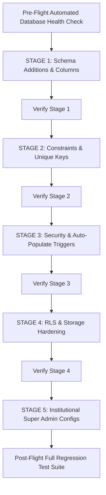

# Database Deployment & Rollback Plan

> **Document Version:** 1.0.0 (Phase 0.3 Staged Deployment Architecture)  
> **Deployment Architecture:** Single-Institution Dedicated Deployment  
> **Target Database:** Supabase PostgreSQL (`ogbbyqxulhegwvrtinib.supabase.co`)  
> **Verification Date:** 2026-11-19  
> **Mode:** Deployment Engineering & Safeguards Specification Only

---

## 1. Executive Summary & Staging Architecture

Rather than executing a monolithic 500-line SQL file in an all-or-nothing blitz, Phase 1 deployment is structured into **five discrete, verifiable stages**. 

Each stage is completely isolated, self-validating, and equipped with:
- **Preconditions:** Automated check queries that must pass before execution.
- **Expected Database Changes:** Explicit DDL/DML footprint.
- **Verification SQL:** Automated query proving the stage succeeded.
- **Application Compatibility Checks:** Verifying Vite frontend and API stability.
- **Failure Scenarios & Rollback/Forward-Recovery:** Exact instructions in case of error.



---

## 2. Pre-Flight Automated Health Check

Before executing Stage 1, run the following read-only SQL check to confirm database baseline stability:

```sql
DO $$
DECLARE
    v_profiles_count INT;
    v_attendance_count INT;
    v_duplicate_sessions INT;
    v_invalid_roles INT;
BEGIN
    SELECT COUNT(*) INTO v_profiles_count FROM public.profiles;
    SELECT COUNT(*) INTO v_attendance_count FROM public.class_attendance_sessions;
    
    -- Check for duplicate attendance natural keys
    SELECT COUNT(*) INTO v_duplicate_sessions FROM (
        SELECT class_name, session_date, period_number, subject_code
        FROM public.class_attendance_sessions
        GROUP BY class_name, session_date, period_number, subject_code
        HAVING COUNT(*) > 1
    ) sub;

    -- Check for illegal roles
    SELECT COUNT(*) INTO v_invalid_roles 
    FROM public.profiles 
    WHERE role NOT IN (
        'student', 'parent', 'teacher', 'admin', 'principal',
        'hod', 'coe', 'financier', 'accountant', 'storekeeper',
        'store_manager', 'finance_manager', 'transport_driver',
        'driver', 'receptionist', 'naac_coordinator', 'hr_manager',
        'librarian', 'hostel_warden', 'placement_officer'
    );

    IF v_duplicate_sessions > 0 THEN
        RAISE EXCEPTION 'Pre-Flight Failed: % duplicate attendance sessions found.', v_duplicate_sessions;
    END IF;

    IF v_invalid_roles > 0 THEN
        RAISE EXCEPTION 'Pre-Flight Failed: % profiles have invalid roles.', v_invalid_roles;
    END IF;

    RAISE NOTICE 'Pre-Flight PASSED: % profiles, % sessions, 0 duplicates, 0 invalid roles.', v_profiles_count, v_attendance_count;
END $$;
```

---

## 3. Staged Migration Sequence

---

### Stage 1: Schema Prerequisite Additions (Non-Breaking Columns)

#### 1. Scope
Add essential academic, status, and reception columns using `ALTER TABLE ... ADD COLUMN IF NOT EXISTS`.
- `profiles.status`, `profiles.login_id`
- `timetables.course_name`, `timetables.year_semester`, `timetables.room_lab`
- `exams.course`, `exams.semester`, `exams.is_published`, etc.
- `exam_results.subject_code`, `exam_results.result_status`, `exam_results.is_published`
- `reception_visitors`, `reception_appointments`, `reception_enquiries` fields

#### 2. Preconditions
- Live database accessible; `profiles`, `timetables`, `exams`, `exam_results` exist.

#### 3. Expected Database Changes
- 18 new columns added with constant defaults. Zero data modified or removed.

#### 4. Verification SQL
```sql
SELECT column_name, data_type 
FROM information_schema.columns 
WHERE table_name = 'profiles' AND column_name IN ('status', 'login_id');
-- Expected: 2 rows returned ('status', 'login_id')
```

#### 5. Application Compatibility Check
- Verify `npx tsc --noEmit` and existing React queries continue reading profiles without error.

#### 6. Failure Scenario & Rollback
- **Failure:** Lock acquisition timeout if long-running query blocks `ALTER TABLE`.
- **Remediation:** Kill conflicting long query or retry with `SET lock_timeout = '5s'`.
- **Rollback:** `ALTER TABLE <table> DROP COLUMN IF EXISTS <column>;`

---

### Stage 2: Check Constraints & Unique Keys

#### 1. Scope
Deploy updated `profiles_role_check` (adding `coe`, `hod`), `profiles_status_check`, and `uq_class_attendance_session`.

#### 2. Preconditions
- Pre-flight check confirms 0 duplicate attendance sessions and 0 illegal roles.

#### 3. Expected Database Changes
- `profiles_role_check` expanded from 18 to 20 role identifiers.
- `uq_class_attendance_session` unique index constructed.
- Partial unique index `idx_profiles_login_id_unique` constructed on non-null `login_id`.

#### 4. Verification SQL
```sql
SELECT conname, contype 
FROM pg_constraint 
WHERE conname IN ('profiles_role_check', 'profiles_status_check', 'uq_class_attendance_session');
-- Expected: 3 rows returned
```

#### 5. Application Compatibility Check
- Test inserting mock user with `role = 'coe'`; verify insert succeeds.

#### 6. Failure Scenario & Rollback
- **Failure:** Row violation if unexpected role exists.
- **Rollback:**
  ```sql
  ALTER TABLE public.class_attendance_sessions DROP CONSTRAINT IF EXISTS uq_class_attendance_session;
  ALTER TABLE public.profiles DROP CONSTRAINT IF EXISTS profiles_role_check;
  -- Re-add baseline 015 constraint
  ALTER TABLE public.profiles ADD CONSTRAINT profiles_role_check CHECK (role IN (...));
  ```

---

### Stage 3: Security & Auto-Population Triggers

#### 1. Scope
Deploy stored functions and triggers:
- `protect_profile_sensitive_columns()` + `trg_protect_profile_columns` on `profiles`.
- `set_exam_result_student_name()` + `trg_set_exam_result_student_name` on `exam_results`.
- `sync_staff_leave_balance_transition()` + `trg_sync_staff_leave_balance` on `staff_leave_applications`.
- Fix `trg_notify_new_concern()` column reference (`NEW.concern_type`).
- Append `SET search_path = public` across all `SECURITY DEFINER` functions.

#### 2. Preconditions
- Stages 1 and 2 completed.

#### 3. Expected Database Changes
- 4 stored procedures created/replaced with `SET search_path = public`.
- 3 new triggers attached (`BEFORE UPDATE`, `BEFORE INSERT`, `AFTER INSERT OR UPDATE OR DELETE`).

#### 4. Verification SQL
```sql
SELECT tgname, relname 
FROM pg_trigger t 
JOIN pg_class c ON c.oid = t.tgrelid 
WHERE tgname IN ('trg_protect_profile_columns', 'trg_set_exam_result_student_name', 'trg_sync_staff_leave_balance');
-- Expected: 3 rows returned
```

#### 5. Application Compatibility Check
- Perform test update on student profile bio (should succeed).
- Perform test update attempting to change `role` to `'admin'` (must fail with exception).

#### 6. Failure Scenario & Rollback
- **Failure:** Syntax error in PL/pgSQL function body.
- **Rollback:**
  ```sql
  DROP TRIGGER IF EXISTS trg_protect_profile_columns ON public.profiles;
  DROP TRIGGER IF EXISTS trg_set_exam_result_student_name ON public.exam_results;
  DROP TRIGGER IF EXISTS trg_sync_staff_leave_balance ON public.staff_leave_applications;
  ```

---

### Stage 4: Row Level Security Hardening & Storage Hardening

#### 1. Scope
- Drop all 17 legacy permissive policies (`USING (true)`).
- Create partitioned, role-restricted policies on attendance, payroll, leaves, hall tickets.
- Restrict `documents` storage bucket deletion.

#### 2. Preconditions
- Stages 1, 2, and 3 completed.

#### 3. Expected Database Changes
- Permissive policies dropped; strict role-based policies active.
- Storage delete restricted to admins or file owners.

#### 4. Verification SQL
```sql
-- Confirm no policy on class_attendance_sessions has definition 'true'
SELECT polname, polcmd, polqual 
FROM pg_policy 
WHERE polrelid = 'public.class_attendance_sessions'::regclass;
-- Expected: Only role-restricted policies returned
```

#### 5. Application Compatibility Check
- Authenticate as student in test runner; verify attendance reads succeed, but writes fail.
- Authenticate as teacher; verify attendance marking for assigned class succeeds.

#### 6. Failure Scenario & Rollback
- **Failure:** Teacher locked out of marking attendance if class assignment query fails.
- **Rollback:**
  ```sql
  -- Restore temporary permissive policy if critical operational blockage occurs
  CREATE POLICY "att_sessions_temp_fallback" ON public.class_attendance_sessions FOR ALL TO authenticated USING (true);
  ```

---

### Stage 5: Institutional Super Admin Configurations

#### 1. Scope
- Create `super_admin_configs`, `super_admin_releases`, and `super_admin_audit_logs` (from Migration 026) scoped natively to this institution without multi-college tenant FKs.

#### 2. Preconditions
- Stage 4 completed.

#### 3. Expected Database Changes
- 3 tables created for institutional customization.

#### 4. Verification SQL
```sql
SELECT table_name 
FROM information_schema.tables 
WHERE table_name IN ('super_admin_configs', 'super_admin_releases', 'super_admin_audit_logs');
-- Expected: 3 rows returned
```

#### 5. Application Compatibility Check
- Open `/admin` control center; verify settings draft and publish workflows function.

#### 6. Failure Scenario & Rollback
- **Rollback:** `DROP TABLE IF EXISTS public.super_admin_configs, public.super_admin_releases, public.super_admin_audit_logs CASCADE;`

---

## 4. Rollback Feasibility & Irreversible Actions

### 4.1 Automated vs Manual Rollback Capabilities

| Change Type | Automatic Rollback via `028_rollback.sql`? | Irreversible Element / Risk |
| :--- | :---: | :--- |
| **New Columns Added** | **Yes** (`DROP COLUMN`) | Any new data written to new columns would be discarded upon column drop. |
| **Triggers Added** | **Yes** (`DROP TRIGGER`) | Fully safe. Dropping trigger removes logic immediately. |
| **Check Constraints** | **Yes** (`DROP CONSTRAINT`) | Fully safe. Re-applying 015 constraint restores previous whitelist. |
| **RLS Policies** | **Yes** (`DROP / CREATE POLICY`) | Fully safe. Dropping restricted policies and re-applying permissive ones restores baseline. |
| **Dropped Permissive Policies** | **Yes** (Re-create statements in rollback script) | If rollback occurs, legacy policies are restored verbatim. |

### 4.2 The Single Irreversible Element
If the system operates under Stage 3 (Leave balance state machine) and users record new leave approvals or cancellations, rolling back the trigger will leave `staff_leave_balances` at their adjusted states. Reconciling balances would require a manual recalculation script. To prevent this, the deployment window should be scheduled during low-traffic periods.

---

## 5. Deployment Checklist & Gate Controls

```markdown
- [ ] Pre-Flight Automated Health Check executed and PASSED.
- [ ] Backup snapshot of Supabase database confirmed.
- [ ] Stage 1 executed: Missing columns added.
- [ ] Stage 1 verification query passed.
- [ ] Stage 2 executed: Constraints & unique keys added.
- [ ] Stage 2 verification query passed.
- [ ] Stage 3 executed: Triggers & stored functions deployed.
- [ ] Stage 3 verification query passed.
- [ ] Stage 4 executed: RLS & storage hardened.
- [ ] Stage 4 verification query passed.
- [ ] Stage 5 executed: Super admin configs tables created.
- [ ] Stage 5 verification query passed.
- [ ] Full automated test suite executed (`scripts/test_full_college_workflows_e2e.ts`).
- [ ] Post-flight sign-off report generated.
```
