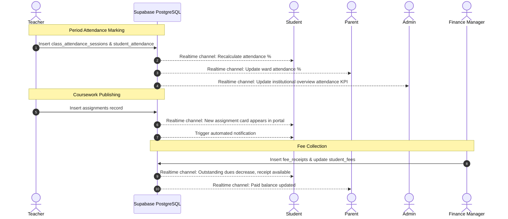

# Complete College Management Software — Data Flow Map

> **Document Version:** 2.0.0 (Phase 0 Audit)  
> **Deployment Architecture:** Single-Institution Dedicated Deployment  
> **Purpose:** Detailed entity-relationship specifications, foreign key bindings, cross-role update propagation mechanisms, duplicate prevention rules, and student data isolation guarantees.

---

## 1. Master Entity Data Flow & Ownership Matrix

| Database Entity / Table | Creator Role | Viewer Roles | Modifier Roles | Key Foreign Keys & Links | Propagation & Dependent Modules |
| :--- | :--- | :--- | :--- | :--- | :--- |
| `profiles` | Admin / Provisioning Engine | Admin, Principal, Self | Admin, Self (preferences only) | `id -> auth.users.id` | Central user identity. All other tables link to `profiles.id` or `roll_number`. |
| `admission_applications` | Receptionist / Candidate | Admin, Principal, Receptionist, Finance | Admin, Principal, Receptionist | `course_id -> courses.id` | Feeds into Student Admission, Merit Lists, and Account Provisioning. |
| `parent_student_links` | Admin / Provisioning Engine | Admin, Principal, Parent | Admin | `parent_id -> profiles.id`, `student_id -> profiles.id` | Governs Parent Portal access. Controls which child a parent can monitor. |
| `departments` | Admin | All Roles | Admin, Principal | `head_of_department_id -> profiles.id` | Academic taxonomy. Organizes faculty, students, courses, and timetables. |
| `courses` | Admin | All Roles | Admin, Principal | `department_id -> departments.id` | Links student enrollments, exam schedules, and fee structures. |
| `timetables` | Admin, Principal | Faculty, Students, Parents | Admin, Principal | `course_id -> courses.id`, `faculty_id -> profiles.id` | Feeds daily schedules in Student and Teacher dashboards. |
| `class_attendance_sessions` | Teacher | Admin, Principal, Teacher | Teacher, Admin | `faculty_id -> profiles.id`, `class_name` | Crucial denominator for student attendance percentage calculation. |
| `student_attendance` | Teacher | Admin, Principal, Teacher, Student, Parent | Teacher, Admin | `student_id -> profiles.id`, `session_id` | Crucial numerator for student attendance percentage calculation. |
| `assignments` | Teacher | Teacher, Assigned Students, Parents | Teacher | `faculty_id -> profiles.id`, `class_name` | Feeds student homework view and academic performance score. |
| `assignment_submissions` | Student | Teacher, Submitting Student | Teacher (grading) | `assignment_id -> assignments.id`, `student_id -> profiles.id` | Feeds teacher grading desk and student evaluation cards. |
| `exams` | COE, Admin | All Roles | COE, Admin | Academic Year, Semester | Master exam series. Links exam schedules and hall tickets. |
| `exam_schedules` | COE, Admin | All Roles | COE, Admin | `exam_id -> exams.id`, `course_id -> courses.id` | Feeds student exam timetable and parent calendar. |
| `hall_tickets` | COE, Admin | Student, Parent, COE | COE, Admin | `exam_id -> exams.id`, `student_id -> profiles.id` | Official admission ticket for examination halls. |
| `exam_results` | Teacher, COE | Student, Parent, Teacher, Principal, Admin | Teacher, COE | `exam_id -> exams.id`, `student_id -> profiles.id` | Directly drives GPA calculation, report cards, and performance analytics. |
| `fee_structures` | Finance Manager | Finance Manager, Admin, Receptionist | Finance Manager, Admin | `course_id -> courses.id` | Defines total semester and annual fee packages. |
| `student_fees` | Finance Manager | Student, Parent, Finance Manager, Admin | Finance Manager, Admin | `student_id -> profiles.id`, `fee_structure_id` | Tracks total payable, total paid, and outstanding balances. |
| `fee_receipts` | Cashier, Receptionist | Student, Parent, Finance Manager, Admin | Finance Manager | `student_id -> profiles.id`, `roll_number` | Dual lookup receipt history with official transaction references. |
| `store_products` | Store Manager | All Roles | Store Manager | Category, SKU | Feeds campus store catalog and stock reorder alerts. |
| `store_orders` | Student, Staff | Student (own), Store Manager, Admin | Store Manager (status) | `user_id -> profiles.id` | Feeds store order fulfillment queue and personal order history. |
| `transport_vehicles` | Transport Driver, Admin | All Roles | Transport Driver, Admin | Route ID, Driver ID | Fleet telematics and vehicle maintenance tracking. |
| `transport_stops` | Transport Driver, Admin | All Roles | Transport Driver, Admin | `route_id -> transport_routes.id` | Stop timings and student pickup coordination. |
| `student_transport_logs` | Driver | Driver, Student, Parent, Admin | Driver | `vehicle_id`, `student_id` | Real-time passenger boarding and transit progress. |
| `library_books` | Librarian | All Roles | Librarian | ISBN, Subject, Shelf | OPAC search and book availability status. |
| `book_issues` | Librarian | Librarian, Student, Faculty | Librarian | `book_id -> library_books.id`, `user_id -> profiles.id` | Circulation ledger, due dates, and overdue late fine computation. |
| `staff_service_records` | HR Manager, Admin | HR Manager, Admin, Self | HR Manager, Admin | `user_id -> profiles.id` | Employment contracts, salary scale, qualifications. |
| `staff_leave_applications` | Staff Member | Staff Member, HR Manager, Principal | HR Manager, Principal | `user_id -> profiles.id` | Leave approvals and deduction from leave balances. |
| `staff_payroll_runs` | HR Manager | HR Manager, Finance Manager, Admin | HR Manager | Month, Year | Monthly salary disbursements and payslip generation. |
| `hostel_rooms` | Warden | Warden, Admin, Resident Students | Warden | Block, Room No | Bed occupancy and allocation. |
| `hostel_out_passes` | Student | Student, Parent, Warden | Parent (consent), Warden (sign-off) | `student_id -> profiles.id` | Gate exit permissions and curfew monitoring. |
| `placement_drives` | Placement Officer | All Eligible Students, Placement Officer | Placement Officer | Company, Drive Date | Campus recruitment announcements and requirements. |
| `placement_applications` | Student | Student, Placement Officer | Placement Officer | `drive_id -> placement_drives.id`, `student_id -> profiles.id` | Resume submission, shortlisting, and placement offer status. |
| `concerns` | Student, Parent | Student (own), Parent (own), Admin, Principal | Admin, Principal | `student_id -> profiles.id` | Grievance escalation and official resolution note feedback. |
| `notifications` | System / Admin | Target User / Broadcast (`null`) | Target User (mark read) | `user_id -> profiles.id` | Real-time event notifications and institutional broadcasts. |

---

## 2. Cross-Role Realtime Update Propagation

---

## 3. Duplicate Prevention & Data Integrity Invariants

1. **Student Account Duplication**:
   - `profiles.student_id` and `profiles.roll_number` have UNIQUE indexes.
   - Bulk account provisioning checks for existing accounts before invoking Supabase Auth.
   - Linking accounts to existing student profiles enforces single-source-of-truth.

2. **Parent Account Reuse**:
   - When a parent has multiple children, the bulk importer queries `profiles` by parent email. If the parent already has an account, it avoids creating a duplicate auth user and simply inserts a new mapping into `parent_student_links`.

3. **Fee Receipts Reference**:
   - `fee_receipts.receipt_number` and `fee_receipts.transaction_reference` are enforced with UNIQUE constraints.
   - Dual-lookup queries (`student_id` or `roll_number`) guarantee no payment record is duplicated or rendered twice.

4. **Conducted Attendance Sessions**:
   - `class_attendance_sessions` enforces unique session per class, section, subject, date, and period index. Teachers cannot duplicate session conduct counts.

5. **Store Order Deductions**:
   - Stock quantities in `store_products` are decremented atomically via Supabase database functions, preventing race conditions or overselling.

---

## 4. Student Data Isolation Architecture

To ensure zero cross-student leakage:

1. **Query Construction**:
   - All student portal queries explicitly bind `.eq('student_id', user.id)` or `.eq('roll_number', user.roll_number)`.
2. **Parent Query Construction**:
   - Parents first fetch all authorized ward IDs via `parent_student_links` where `parent_id = user.id`.
   - All subsequent queries for attendance, marks, fees, and assignments bind `.in('student_id', authorizedStudentIds)`.
3. **Database RLS Policies**:
   - Row Level Security policies enforce that `auth.uid() = student_id` or `is_parent_of(auth.uid(), student_id)`.
