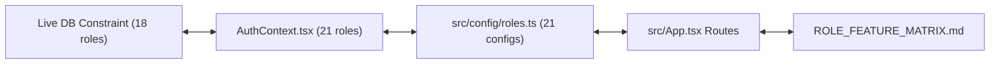
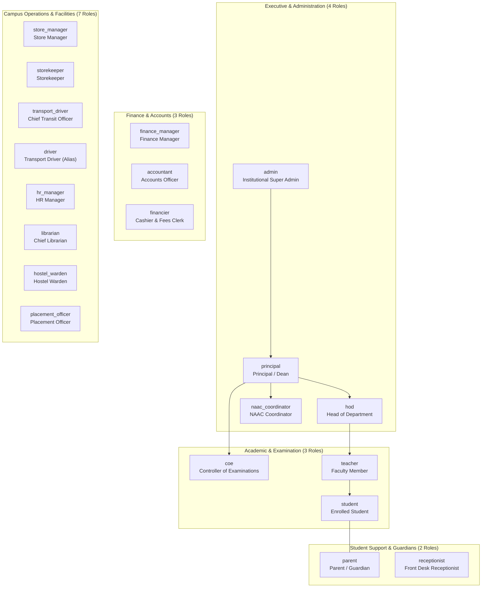

# Authoritative Institutional Role Registry

> **Document Version:** 1.0.0 (Phase 0.4 Reconciled Single-Institution Role Model)  
> **Deployment Architecture:** Single-Institution Dedicated Deployment  
> **Target System:** ADHITYAN College Management Software  
> **Verification Date:** 2026-11-19  
> **Exclusion Notice:** `platform_super_admin` is **permanently excluded** from this institutional registry as the deployment is dedicated to one college.

---

## 1. Cross-Tier Reconciliation & Divergence Analysis

Before establishing the definitive registry, an exhaustive comparison was performed across the six sources of role definitions in the codebase:



### 1.1 Cross-Tier Comparison Findings

| Source / Tier | File Location | Declared Roles Count | Divergences & Anomalies Identified |
| :--- | :--- | :---: | :--- |
| **1. Live DB Constraint** | `015_add_principal_role_constraint.sql#L12-L31` | **18 roles** | **Missing `coe` and `hod`**. Includes `driver` and `transport_driver`. |
| **2. AuthContext Type** | `src/context/AuthContext.tsx#L6-L28` | **21 roles** | Includes `platform_super_admin`, `coe`, `hod`, `driver`, `transport_driver`. |
| **3. Roles Configuration** | `src/config/roles.ts#L17-L241` | **21 configs** | Includes `platform_super_admin`. **Corrupted `naac_coordinator.role = 'admin'`**. |
| **4. Database Types** | `src/types/database.types.ts#L1-L15` | **14 roles** | **Missing `coe`, `hod`, `hr_manager`, `librarian`, `hostel_warden`, `placement_officer`**. |
| **5. Route Guards** | `src/App.tsx#L140-L360` | **20 roles** | Handles `coe`, `librarian`, `receptionist`, `driver`, `transport_driver`. |
| **6. Dashboard Switch** | `src/pages/Dashboard.tsx#L104-L150` | **19 portals** | Groups `hod` $\to$ `TeacherDashboard`, `driver` $\to$ `TransportDriverDashboard`. |

---

## 2. Authoritative Institutional Role Registry (19 Roles + 1 Alias)

The software governs an independent tertiary institution. The platform role (`platform_super_admin`) is **strictly removed**.

The authoritative institutional hierarchy consists of **19 primary functional roles**, with `'driver'` retained in the database check constraint as a backward-compatible operational alias of `'transport_driver'`:



---

## 3. Comprehensive Role Specification Table

| # | Role Key (`role`) | Official Institutional Title | Functional Domain | Dedicated Landing (`home`) | Assigned Dashboard Component | Database Constraint Status |
| :-: | :--- | :--- | :--- | :--- | :--- | :---: |
| **1** | **`admin`** | Institutional Super Admin | Executive & Governance | `/admin` | `<AdminDashboard />` & `<SuperAdminControlCenter />` | Active in DB |
| **2** | **`principal`** | Principal / Academic Dean | Academic Leadership | `/dashboard/principal` | `<PrincipalDashboard />` | Active in DB |
| **3** | **`teacher`** | Faculty Member / Instructor | Academics & Instruction | `/dashboard/teacher` | `<TeacherDashboard />` | Active in DB |
| **4** | **`hod`** | Head of Department | Departmental Academic Oversight | `/dashboard/teacher` | `<TeacherDashboard />` (Dept View) | **Added in 028** |
| **5** | **`coe`** | Controller of Examinations | Examination Cell & Evaluation | `/exam-management` | `<ExamManagement />` (COE Console) | **Added in 028** |
| **6** | **`student`** | Enrolled Student | Academic Recipient | `/dashboard/student` | `<StudentDashboard />` | Active in DB |
| **7** | **`parent`** | Parent / Registered Guardian | Ward Telemetry & Oversight | `/dashboard/parent` | `<ParentDashboard />` | Active in DB |
| **8** | **`finance_manager`** | Finance Manager | Financial Governance | `/dashboard/finance_manager`| `<FinanceManagerDashboard />` | Active in DB |
| **9** | **`accountant`** | Accounts Officer | Institutional Accounting & Ledger | `/dashboard/accountant` | `<FinanceManagerDashboard />` (Ledger View) | Active in DB |
| **10**| **`financier`** | Cashier & Fee Collection Clerk | Fee Counters & Point of Sale | `/dashboard/financier` | `<FinanceManagerDashboard />` (Cashier View) | Active in DB |
| **11**| **`store_manager`** | Campus Store Manager | Inventory & Uniform Procurement | `/dashboard/store_manager` | `<StoreManagerDashboard />` | Active in DB |
| **12**| **`storekeeper`** | Store Dispatcher | Counter Sales & Stock Dispatch | `/dashboard/storekeeper` | `<StoreManagerDashboard />` (Counter View) | Active in DB |
| **13**| **`transport_driver`**| Chief Transit Officer | Fleet Management & Telematics | `/dashboard/transport_driver`| `<TransportDriverDashboard />` | Active in DB |
| **14**| **`receptionist`** | Front Desk Receptionist | Visitor Desk & Admissions Desk | `/dashboard/receptionist` | `<ReceptionistDashboard />` | Active in DB |
| **15**| **`naac_coordinator`**| NAAC Accreditation Coordinator| Quality Assurance & Criteria | `/admin/naac` | `<NAACDashboard />` | Active in DB |
| **16**| **`hr_manager`** | Human Resources Manager | Staff Records, Leaves & Payroll | `/dashboard/hr_manager` | `<HRManagerDashboard />` | Active in DB |
| **17**| **`librarian`** | Chief Librarian | Digital & Physical Library | `/dashboard/librarian` | `<LibrarianDashboard />` | Active in DB |
| **18**| **`hostel_warden`** | Hostel Warden | Boarding, Rooms & Out-Passes | `/dashboard/hostel_warden` | `<HostelWardenDashboard />` | Active in DB |
| **19**| **`placement_officer`**| Placement & Training Officer| Corporate Drives & Internships | `/dashboard/placement_officer`| `<PlacementOfficerDashboard />` | Active in DB |
| **20**| **`driver`** *(Alias)*| Transport Fleet Driver | Route Execution & Bus GPS | `/dashboard/driver` | `<TransportDriverDashboard />` (Route View) | Active in DB |

---

## 4. Phase 1 Code Alignment Directives

To enforce this authoritative registry across all system tiers in Phase 1:

1. **PostgreSQL Check Constraint (`028_stage2_constraints.sql`):**
   ```sql
   ALTER TABLE public.profiles DROP CONSTRAINT IF EXISTS profiles_role_check;
   ALTER TABLE public.profiles ADD CONSTRAINT profiles_role_check CHECK (role IN (
       'student', 'parent', 'teacher', 'admin', 'principal',
       'hod', 'coe', 'financier', 'accountant', 'storekeeper',
       'store_manager', 'finance_manager', 'transport_driver',
       'driver', 'receptionist', 'naac_coordinator', 'hr_manager',
       'librarian', 'hostel_warden', 'placement_officer'
   ));
   ```

2. **TypeScript Union Alignment (`src/types/database.types.ts` & `src/context/AuthContext.tsx`):**
   - Harmonize `UserRole` across both files to contain exactly these 20 role keys.
   - Remove `'platform_super_admin'` from `UserRole`.

3. **Roles Configuration Alignment (`src/config/roles.ts`):**
   - Correct `ROLE_CONFIGS['naac_coordinator'].role` to `'naac_coordinator'`.
   - Remove `ROLE_CONFIGS['platform_super_admin']`.

4. **Edge Functions Alignment (`supabase/functions/admin-users/index.ts`):**
   - Update `ALLOWED_ROLES` to match all 20 permitted role keys.
