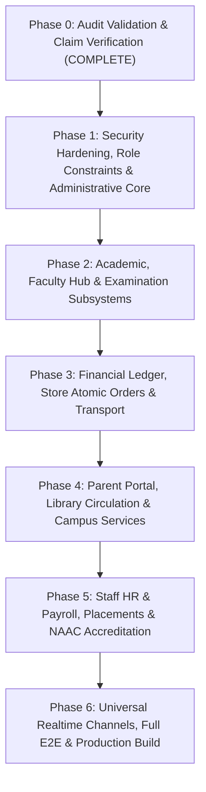

# Authoritative Phased Implementation Plan & Remediation Roadmap

> **Document Version:** 2.2.0 (Phase 0 Complete Source Verification)  
> **Deployment Architecture:** Single-Institution Dedicated Deployment  
> **Governance:** Audit and planning phase only. Implementation proceeds only upon user approval of this plan.

---

## 1. Implementation Principles & Security Safeguards

1. **Security & Integrity Precedes UI**: Critical security vulnerabilities (`BUG-SEC-001`, `BUG-SEC-002`, `BUG-RLS-001`, `BUG-ROLE-001`, `BUG-ROLE-002`, `BUG-ATT-001`) must be remediated in PostgreSQL migrations and authentication context before building frontend integrations.
2. **Dedicated Single-Institution Boundaries**: Preserve the private single-college database architecture without cross-tenant complexity.
3. **Zero Deletions or Regressions**: Every existing feature is preserved and upgraded from partial/static state to 100% backend persistence.
4. **Automated Verification Gates**: Each phase concludes with an automated E2E test suite running against real Supabase tables with a 100% pass rate.

---

## 2. Phased Roadmap Overview

---

## 3. Phase-by-Phase Remediation Roadmap

### Phase 1: Security Hardening, Role Constraints & Administrative Core
- **Database Migrations & Security Patches**:
  - Deploy `protect_profile_role_update` trigger on `public.profiles` blocking non-admin role self-modification (`BUG-SEC-001`).
  - Tighten `class_attendance_sessions` RLS policy from `USING (true)` to role-restricted (`BUG-RLS-001`).
  - Update `profiles_role_check` constraint to include all 19 roles, specifically adding `'coe'` and `'hod'` (`BUG-ROLE-001`).
  - Add UNIQUE constraint on `(class_name, session_date, period_number, subject_code)` in `class_attendance_sessions` to prevent duplicate session conduct increments (`BUG-ATT-001`).
  - Fix trigger `trg_notify_new_concern` to reference `COALESCE(NEW.concern_type, 'General')` (`BUG-CONCERN-001`).
- **Client Authentication & Role Alignment**:
  - Rewrite `mapAuthToUser` in `src/context/AuthContext.tsx` to strictly prioritize database `profileData.role` over `user_metadata.role` and email prefixes (`BUG-SEC-002`).
  - Correct `role: 'naac_coordinator'` in `src/config/roles.ts#L178` to eliminate erroneous mapping to `'admin'` (`BUG-ROLE-002`).
- **Administrative Core & Provisioning**:
  - Implement structured CSV/Excel report generator in `AdminReports.tsx` (`GAP-ADM-001`).
  - Verify complete separation of Student Admission approval from Student/Parent login account provisioning.
  - Implement structured CSV export in `ReportsModule.tsx` for Principal (`GAP-PRIN-001`).
- **Verification Milestone**:
  - Execute automated security test verifying that student tokens cannot elevate their role, attendance sessions cannot be written by students, and duplicate sessions are rejected by PostgreSQL.

---

### Phase 2: Academic, Faculty Hub & Examination Subsystems
- **Faculty Operations & Attendance**:
  - Verify period attendance marking in `PeriodAttendanceDesk.tsx` inserting into `class_attendance_sessions` and `student_attendance`.
  - Enforce attendance percentage formula: $\left(\frac{\text{Present} + 0.5 \times \text{Late}}{\text{Conducted Sessions}}\right) \times 100$.
  - Implement student progress card export in `GenerateReport.tsx` (`GAP-TCH-001`).
- **Examination Engine**:
  - Standardize grade intervals $[a, b)$ to eliminate fractional boundary overlaps.
  - Add default subquery for `student_name` in `exam_results` (`BUG-EXAM-001`).
  - Verify master exam creation, schedule publishing, hall ticket issuance, marks entry, and result publishing.
- **Verification Milestone**:
  - Automated test running: Teacher attendance submission $\rightarrow$ student percentage check $\rightarrow$ coursework grading $\rightarrow$ exam schedule creation $\rightarrow$ result publishing.

---

### Phase 3: Financial Ledger, Store Atomic Orders & Transport
- **Finance Subsystem**:
  - Verify fee dual lookup retrieval (`student_id` or `roll_number`), payment voucher recording, and receipt generation.
  - Enforce unique transaction references and idempotent receipt queries.
  - Connect in-app alert dispatcher for fee reminders (`GAP-FIN-001`).
- **Campus Store Subsystem**:
  - Require order placement to execute exclusively through the atomic PostgreSQL RPC function `place_store_order`, removing race-prone client loop fallback (`BUG-STR-001`).
  - Verify order status state machine (`Pending` $\rightarrow$ `Processing` $\rightarrow$ `Completed` $\rightarrow$ `Cancelled`).
- **Transport Subsystem**:
  - Connect driver transit progress logs with bus route waypoints and student stop notifications (`GAP-TRN-001`).
- **Verification Milestone**:
  - Automated test executing fee payment, store order placement with stock check, and driver transit log updates.

---

### Phase 4: Parent Portal, Library Circulation & Campus Services
- **Parent Portal**:
  - Verify multi-ward child switching and isolated data queries for linked parents.
  - Confirm parent queries enforce `psl.verified = true` via `parent_student_links`.
- **Library Subsystem**:
  - Fix `BookIssueDialog.tsx` to dynamically query active loans in `book_issues` instead of hardcoding `currentBooks: 0, maxBooks: 5` (`BUG-LIB-001`).
  - Add manual ISBN search input box as prominent fallback alongside camera viewfinder in `QRScannerDialog.tsx` (`GAP-LIB-001`).
- **Campus Operations**:
  - Verify student medical clinic visit logs, disciplinary committee hearings, and sports team rosters (`GAP-SPT-001`).
- **Verification Milestone**:
  - Parent portal test validating ward switching and library borrowing limit enforcement.

---

### Phase 5: Staff HR & Payroll, Placements & NAAC Accreditation
- **Human Resources & Payroll**:
  - Deploy PostgreSQL trigger on `staff_leave_applications` decrementing corresponding leave balance in `staff_leave_balances` when `status = 'Approved'` (`BUG-HR-001`).
  - Support configurable tax deduction rules in `StaffPayrollEngine.tsx`.
- **Placement Cell**:
  - Verify recruitment drives, student resume applications, shortlisting, and corporate recruiter directory.
- **NAAC Quality Assurance**:
  - Implement automated report bundler compiling all 7 criteria metrics and file attachment links into an executive SSR document (`GAP-NAC-001`).
- **Verification Milestone**:
  - Automated test verifying staff leave approval with balance deduction, payroll calculation, placement application, and NAAC SSR metric audit.

---

### Phase 6: Universal Realtime Channels, Full E2E & Production Build
- **Universal Synchronization**:
  - Ensure real-time subscriptions across all 19 role dashboards.
- **Full Regression Testing**:
  - Execute master end-to-end regression test suite covering all 118 cataloged features.
- **Production Build**:
  - Run `npm run build` and `tsc --noEmit` confirming zero errors.
