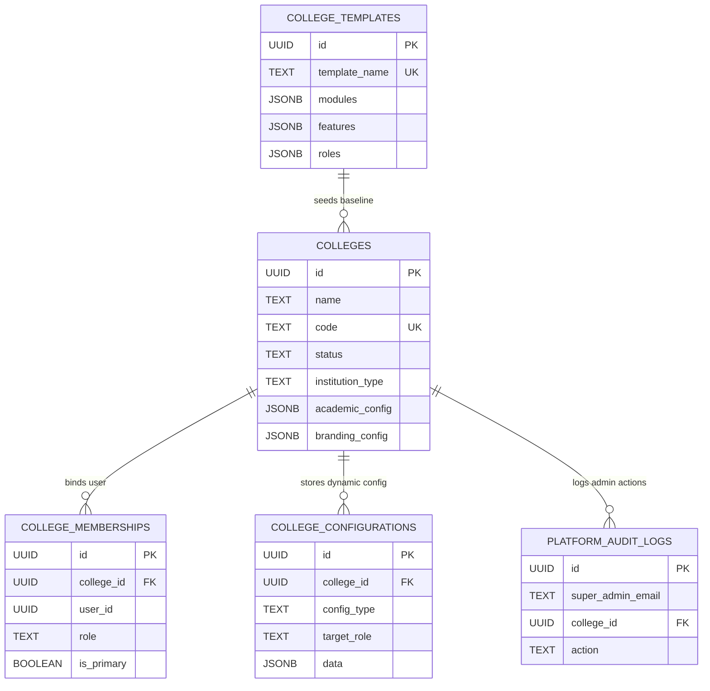

# Migration 027 Architecture Review: Multi-College Platform Decoupling

> **Document Version:** 1.0.0 (Phase 0.3 Architecture Analysis)  
> **Deployment Architecture:** Single-Institution Dedicated Deployment  
> **Target Scope:** `027_multi_college_platform_architecture.sql` and Connected TypeScript Subsystems  
> **Verification Date:** 2026-11-19  
> **Rule Compliance:** Zero files deleted; architectural recommendations only.

---

## 1. Executive Summary

The ADHITYAN College Management Software architecture requires that **each college has its own completely separate software deployment, its own Supabase project/database, and its own Super Admin**.

However, during earlier development, **Migration 027** (`027_multi_college_platform_architecture.sql`) and several TypeScript services were drafted to implement a SaaS-style multi-tenant platform architecture. This introduced concepts such as:
- A `colleges` table and `college_memberships` table.
- A `platform_super_admin` role possessing cross-institution tenant-switching powers.
- Tenant identifiers (`college_id`) across configuration models.
- Cross-tenant data filtering in client-side services.

This review provides a comprehensive inventory of all multi-college constructs in both SQL and TypeScript, explains why deploying Migration 027 to the live database directly conflicts with the dedicated deployment mandate, and provides precise recommendations on what to **exclude**, **retain**, or **redesign** for an independent institution.

---

## 2. Multi-College Components in Migration 027

### 2.1 Schema Objects Introduced by Migration 027

### 2.2 Table-by-Table Architectural Assessment

| Table / Object | Declared Purpose in 027 | Conflict with Dedicated Single-Institution Model | Recommendation |
| :--- | :--- | :--- | :---: |
| **`public.colleges`** | Registry of multiple tenant institutions sharing one database | In a dedicated deployment, the entire database belongs to one institution. Having a table of colleges creates confusion and overhead. | **EXCLUDE from Database Deployment** |
| **`public.college_memberships`** | Maps users to multiple colleges with switching roles | Students and faculty belong strictly to this dedicated college instance. | **EXCLUDE from Database Deployment** |
| **`public.college_configurations`** | Per-college dynamic role, feature, and module JSONB configurations | **Useful functionality, wrong scope:** Config customization is valuable for the college Super Admin, but does not need `college_id` FK. | **REDESIGN into `super_admin_configs`** |
| **`public.college_templates`** | Pre-packaged ERP blueprints for provisioning new colleges | Provisioning multiple colleges from one platform is not applicable in a single-college dedicated instance. | **EXCLUDE from Database Deployment** |
| **`public.platform_audit_logs`** | Audit trail for external platform super admin actions | Auditing is already handled by `public.audit_logs` and `super_admin_audit_logs` for institutional admins. | **EXCLUDE from Database Deployment** |

---

## 3. Multi-College Subsystems Across Application Code

An inspection of the repository identified six TypeScript subsystems containing multi-college logic:

### 3.1 `src/context/CollegeContext.tsx`
- **Current Behavior:** Exposes `CollegeProvider`, `currentCollege`, `switchCollege(collegeId)`, and `isPlatformSuperAdmin`.
- **Tenant Identifier:** Stores active college ID in browser local storage: `localStorage.getItem('adhityan_active_tenant_id')` or defaults to hardcoded UUID `11111111-1111-1111-1111-111111111111`.
- **Cross-College Access Path:** Lines 48–55 allow users with role `'platform_super_admin'` or email `'superadmin@platform.adithyan.edu'` to switch active colleges on the fly.
- **Architectural Conflict:** Bypasses institutional isolation; creates the illusion of a multi-tenant platform.
- **Redesign Recommendation:** Convert `CollegeContext` into a lightweight **`InstitutionContext`** that loads the dedicated college's name, logo, academic calendar, and settings from `public.institutional_settings` without tenant switching.

---

### 3.2 `src/services/multiCollegeService.ts`
- **Current Behavior:** Implements CRUD for `colleges`, provisions new colleges, provisions initial admin accounts, manages `college_templates`, and logs to `platform_audit_logs`.
- **Redesign Recommendation:** Retain on disk (per strict instructions not to delete code), but isolate it from core application routes. The institutional Super Admin will interface with `superAdminService.ts` for institutional configurations.

---

### 3.3 `src/services/collegeDataService.ts`
- **Current Behavior:** Contains `setCollegeContext(collegeId: string)` and appends `.eq('college_id', this.currentCollegeId)` to queries.
- **Architectural Conflict:** In the live database, core tables (`profiles`, `departments`, `timetables`, `student_attendance`) **do not possess a `college_id` column**. If `collegeDataService` attempts to filter by `college_id`, PostgREST returns error `42703 (undefined_column)`.
- **Redesign Recommendation:** Decouple from mandatory `college_id` filtering. Query the database tables directly, as all rows belong to this institution.

---

### 3.4 `src/components/platformAdmin/` Directory
- **Current Components:**
  - `PlatformAdminLayout.tsx`
  - `CollegesDirectory.tsx`
  - `CollegeProvisioningWizard.tsx`
  - `ConfigurationTemplates.tsx`
  - `PlatformAuditLogs.tsx`
  - `PlatformSettings.tsx`
- **Current Routing:** Exposed under `/platform-admin/*` in `src/config/roles.ts`.
- **Redesign Recommendation:** Retain files on disk. In single-institution deployments, disable the `/platform-admin` route from the standard college navigation and restrict Super Admin access to `/admin` and `/admin/control-center`.

---

### 3.5 `src/server/adminBackend.ts`
- **Current Behavior:** Lines 68, 129, 142, and 3129–3224 check `callerRole === 'platform_super_admin'` for provisioning actions.
- **Redesign Recommendation:** Ensure institutional leadership (`admin` and `principal`) possess full provisioning authority without requiring a platform super admin role.

---

## 4. Retain, Exclude & Redesign Matrix

| Component | Target File / Table | Classification | Detailed Justification & Architectural Strategy |
| :--- | :--- | :---: | :--- |
| **`colleges` Table** | `027_multi_college_platform_architecture.sql#L7-L35` | **EXCLUDE** | Database belongs exclusively to this one college. Exclude from live deployment. |
| **`college_memberships` Table** | `027_multi_college_platform_architecture.sql#L41-L56` | **EXCLUDE** | Redundant user mapping. Roles are stored directly in `public.profiles`. |
| **`platform_audit_logs` Table** | `027_multi_college_platform_architecture.sql#L92-L111` | **EXCLUDE** | Audit trail is already provided by `public.audit_logs`. |
| **`college_templates` Table** | `027_multi_college_platform_architecture.sql#L73-L90` | **EXCLUDE** | Template provisioning is unnecessary for a dedicated instance. |
| **`college_configurations`** | `027_multi_college_platform_architecture.sql#L57-L72` | **REDESIGN** | The dynamic role/module JSONB customization feature is valuable. Retain the capability in **`public.super_admin_configs`** (from Migration 026) scoped to this college. |
| **`platform_super_admin` Role** | `roles.ts`, `AuthContext.tsx` | **EXCLUDE** | The highest institutional authority is the College Super Admin (`role: 'admin'`). Omit platform role from database check constraint. |
| **`CollegeContext.tsx`** | `src/context/CollegeContext.tsx` | **REDESIGN** | Re-bind context to read from `institutional_settings`. Remove tenant switching UI. |
| **`collegeDataService.ts`** | `src/services/collegeDataService.ts` | **REDESIGN** | Remove `.eq('college_id', ...)` filters to prevent column-not-found runtime crashes. |
| **`PlatformAdmin` Pages** | `src/components/platformAdmin/*` | **RETAIN ON DISK** | Keep code on disk to satisfy zero-deletion rules; hide from institutional navigation. |

---

## 5. Deployment Safety Conclusion

1. **Migration 027 must NOT be deployed to the live database.**
2. Its multi-tenant tables (`colleges`, `college_memberships`, `college_templates`, `platform_audit_logs`) will be completely excluded from the planned **Migration 028**.
3. All institutional customization capabilities (dynamic modules, role permissions, theme settings) will be powered by **Migration 026 (`super_admin_configs`)** natively scoped to this single institution.
4. No application files will be deleted; routing and services will be configured to operate cleanly within the dedicated institution boundary.
