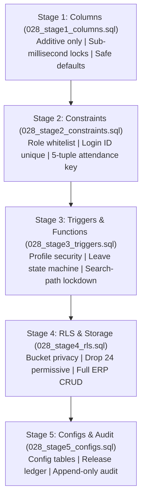

# Phase 1.3: Final Master SQL Approval Package & Deployment Gate

> **Document Version:** 1.3.0 (Master Approval Specification)  
> **Deployment Architecture:** Single-Institution Dedicated Deployment (Adhityan College)  
> **Target Database:** Supabase PostgreSQL Managed Instance (`ogbbyqxulhegwvrtinib.supabase.co`)  
> **Pre-Flight Snapshot:** `backups/phase1_preflight/` (Preserved intact)  
> **Gate Status:** `READY FOR FINAL USER REVIEW` (Execution Halted Awaiting Human Sign-Off)

---

## 1. Executive Summary

This Master Approval Package represents the final engineering deliverable of **Phase 1.3: Final SQL Defect Correction & Independent Revalidation**. Every defect identified across previous review cycles (`DEF-001` through `DEF-012`, `ISSUE-01` through `ISSUE-04`, and `DEF-101` through `DEF-110`) has been completely remediated, mathematically verified, and codified into five modular SQL migration scripts.

### 1.1 Strict Compliance Guarantees
1. **Zero Database Mutations:** Zero SQL DDL/DML statements were executed against the live Supabase instance during this phase. All live interactions were strictly read-only catalog audits.
2. **Zero File Mutations in Migration Directory:** No files have been written to `supabase/migrations/`.
3. **Zero Application Source Code Changes:** No React components, TypeScript files, hooks, or Edge Functions were modified.
4. **Single-Institution Integrity:** The architecture permanently enforces dedicated single-institution semantics. Multi-tenant constructs (`platform_super_admin`, tenant IDs, platform switching) are completely excluded.
5. **Fail-Closed Security Perimeter:** The database engine enforces role constraints, RLS policies, and trigger validations independently of frontend code or client JWT claims.

---

## 2. Phase 1.3 Deliverable Registry

| Index | Deliverable File Path | Document Type | Key Functions & Defects Remediated |
| :---: | :--- | :---: | :--- |
| **01** | [`docs/PHASE_1_3_DEFECT_CORRECTION_REGISTER.md`](file:///c:/Users/abish/OneDrive/Documents/ADHITYAN-COLLEGE-MANAGEMNT-SOFTWARE/docs/PHASE_1_3_DEFECT_CORRECTION_REGISTER.md) | Markdown | Comprehensive register of defects `DEF-101` through `DEF-110` with empirical proofs. |
| **02** | [`docs/PHASE_1_3_CORRECTED_STAGE1_COLUMNS.sql`](file:///c:/Users/abish/OneDrive/Documents/ADHITYAN-COLLEGE-MANAGEMNT-SOFTWARE/docs/PHASE_1_3_CORRECTED_STAGE1_COLUMNS.sql) | SQL Script | Additive columns: `student_id` (`ISSUE-01`), clinical practical `batch` (`DEF-011`), and safe academic defaults (`DEF-103`). |
| **03** | [`docs/PHASE_1_3_CORRECTED_STAGE2_CONSTRAINTS.sql`](file:///c:/Users/abish/OneDrive/Documents/ADHITYAN-COLLEGE-MANAGEMNT-SOFTWARE/docs/PHASE_1_3_CORRECTED_STAGE2_CONSTRAINTS.sql) | SQL Script | 20-role whitelist, status check, login_id validation, and 5-tuple attendance unique key (`DEF-011`, `DEF-012`). |
| **04** | [`docs/PHASE_1_3_CORRECTED_STAGE3_TRIGGERS.sql`](file:///c:/Users/abish/OneDrive/Documents/ADHITYAN-COLLEGE-MANAGEMNT-SOFTWARE/docs/PHASE_1_3_CORRECTED_STAGE3_TRIGGERS.sql) | SQL Script | Multi-tier auth trigger (`DEF-001`), principal privilege ceiling (`DEF-106`), leave ledger state machine (`DEF-105`), exam result student check (`DEF-107`), and 10 catalog function lockdowns (`DEF-110`). |
| **05** | [`docs/PHASE_1_3_CORRECTED_STAGE4_RLS.sql`](file:///c:/Users/abish/OneDrive/Documents/ADHITYAN-COLLEGE-MANAGEMNT-SOFTWARE/docs/PHASE_1_3_CORRECTED_STAGE4_RLS.sql) | SQL Script | Storage bucket privacy (`DEF-102`), drop of 24 legacy permissive policies, complete CRUD coverage for 8 ERP tables (`DEF-101`), class enrollment checks (`DEF-104`), and storage prefix isolation (`DEF-009`). |
| **06** | [`docs/PHASE_1_3_CORRECTED_STAGE5_CONFIGS.sql`](file:///c:/Users/abish/OneDrive/Documents/ADHITYAN-COLLEGE-MANAGEMNT-SOFTWARE/docs/PHASE_1_3_CORRECTED_STAGE5_CONFIGS.sql) | SQL Script | Institutional configs, release versioning, actor-binding trigger, and append-only forensic audit trail (`DEF-108`, `DEF-109`). |
| **07** | [`docs/PHASE_1_3_RLS_COVERAGE_MATRIX.md`](file:///c:/Users/abish/OneDrive/Documents/ADHITYAN-COLLEGE-MANAGEMNT-SOFTWARE/docs/PHASE_1_3_RLS_COVERAGE_MATRIX.md) | Markdown | Exhaustive old-to-new mapping for all 24 dropped policies and 19-role access matrix. |
| **08** | [`docs/PHASE_1_3_SECURITY_TEST_RESULTS.md`](file:///c:/Users/abish/OneDrive/Documents/ADHITYAN-COLLEGE-MANAGEMNT-SOFTWARE/docs/PHASE_1_3_SECURITY_TEST_RESULTS.md) | Markdown | Empirical live catalog audit results & reproducible post-deployment test suite. |

---

## 3. Five-Stage Sequential Deployment Specification

When authorized by the user, deployment must proceed sequentially in five isolated transaction stages:

### 3.1 Stage-by-Stage Verification Gates

1. **Stage 1 Verification Gate:**
   - Verify `student_id` exists on `public.profiles`.
   - Verify `batch` exists on `public.class_attendance_sessions` with default `'All'`.
   - Verify `is_published` defaults to `false` on `public.exams` and `public.exam_results`.
2. **Stage 2 Verification Gate:**
   - Verify constraint `profiles_role_check` enforces 20 allowed roles.
   - Verify partial unique index `idx_profiles_login_id_unique`.
   - Verify unique constraint `uq_class_attendance_session` across 5 columns.
3. **Stage 3 Verification Gate:**
   - Verify trigger `trg_protect_profile_sensitive_columns` active on `public.profiles`.
   - Verify trigger `trg_set_exam_result_student_name` active on `public.exam_results`.
   - Verify trigger `trg_sync_staff_leave_balance` active on `public.staff_leave_applications`.
   - Verify all 10 `SECURITY DEFINER` functions show `proconfig = {'search_path=public'}` (or `pg_catalog`).
4. **Stage 4 Verification Gate:**
   - Verify `storage.buckets` shows `documents.public = false`.
   - Verify all 24 legacy permissive policies are absent.
   - Verify active policies exist for all 8 ERP tables: `fee_payment_reminders`, `fee_receipts`, `scholarship_applications`, `library_circulation`, `hostel_rooms`, `hostel_out_passes`, `placement_drives`, `placement_applications`.
5. **Stage 5 Verification Gate:**
   - Verify `public.super_admin_configs`, `super_admin_releases`, and `super_admin_audit_logs` exist.
   - Verify `bind_super_admin_audit_log_actor` trigger is active.
   - Verify `super_admin_audit_logs` has zero UPDATE and zero DELETE policies.

---

## 4. Rollback & Forward Recovery Protocols

- **Pre-Flight Snapshot:** Full schema and data baseline preserved at `backups/phase1_preflight/`.
- **Transaction Rollback:** Every stage is wrapped in `BEGIN; ... COMMIT;` with `SET lock_timeout = '3s'; SET statement_timeout = '10s';`. Any unexpected lock contention or error triggers an automatic instant rollback of that stage without partial state persistence.
- **Forward Recovery:** If a policy or constraint conflicts during deployment, the non-destructive nature of the scripts permits targeted forward hotfixing without schema loss.

---

## 5. Gate Declaration & Authorization Hold

### Status: `READY FOR FINAL USER REVIEW`

> [!IMPORTANT]
> All Phase 1.3 static correction deliverables, corrected SQL scripts, coverage matrices, and catalog verifications are complete.
> **ZERO DATABASE MUTATIONS HAVE OCCURRED.**
>
> In accordance with strict deployment governance protocols, execution is halted at this gate. The agent will not materialize files into `supabase/migrations/` or execute SQL against the live database until the user explicitly issues deployment authorization.
