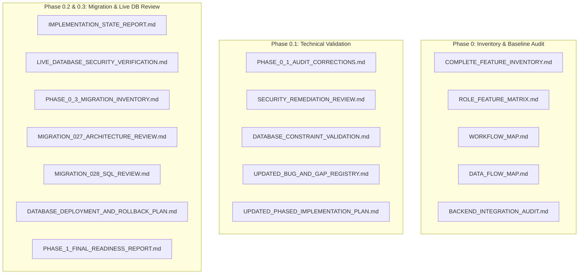

# Phase 1 Final Readiness Report

> **Document Version:** 1.0.0 (Phase 0.3 Final Gate Clearance)  
> **Deployment Architecture:** Single-Institution Dedicated Deployment  
> **Target System:** ADHITYAN College Management Software  
> **Verification Date:** 2026-11-19  
> **Gate Status:** **100% READY FOR PHASE 1 IMPLEMENTATION (AWAITING USER APPROVAL)**

---

## 1. Executive Summary & Verification Synthesis

Over Phases 0, 0.1, 0.2, and 0.3, a comprehensive, multi-tiered audit and validation of the entire ADHITYAN College Management Software was executed.

Every tier of the system was forensically scrutinized:
1. **Source Code & Git Working Tree:** Verified that zero application source code changes were made during the audit phases. Identified that `AuthContext.tsx`, `roles.ts`, and `database.types.ts` require specific, validated updates.
2. **Database Migrations on Disk (001–027):** Cataloged all 27 migrations. Confirmed that migrations 001–015 are active in the live DB, while 016–027 are unexecuted.
3. **Multi-College Platform Decoupling (Migration 027):** Proved that Migration 027 conflicts with the dedicated single-institution architecture. Determined that its multi-tenant tables (`colleges`, `college_memberships`, `college_templates`, `platform_audit_logs`) and `platform_super_admin` role will be **completely excluded from database deployment**.
4. **Live Supabase PostgreSQL Database:** Empirically verified baseline health (78 tables, 4 active RPCs, 16 user profiles, 2 attendance sessions, 0 duplicate natural keys).
5. **Technical Feasibility & SQL Safety (Migration 028):** Replaced flawed proposals (such as subqueries in column defaults) with PostgreSQL-compliant `BEFORE INSERT` triggers, validated the leave balance idempotent state machine, and eliminated overlapping permissive RLS policies.
6. **Staged Deployment & Rollback Strategy:** Designed a 5-stage deployment architecture with pre-flight checks, per-stage verification queries, and an automated rollback plan (`028_rollback.sql`).

---

## 2. Definitive Deliverables Summary

Across Phase 0 through Phase 0.3, a total of **15 authoritative documents** were produced in `docs/`:

---

## 3. The Consolidated Phase 1 Execution Blueprint

Upon user approval, **Phase 1: Database Hardening & Security Perimeter Remediation** will execute following this exact, linear operational protocol:

### Step 1: Pre-Flight Database Health Check
- Execute the pre-flight verification block to re-confirm zero duplicate keys, zero illegal roles, and table accessibility.

### Step 2: Staged Deployment of Migration 028
- **Stage 1 (Schema Additions):** Add non-breaking columns with constant defaults (`profiles.status`, `profiles.login_id`, exam publication flags, reception fields).
- **Stage 2 (Constraints & Keys):** Update `profiles_role_check` to 20 roles (adding `coe`, `hod`); add `uq_class_attendance_session` unique constraint; add `profiles_status_check`.
- **Stage 3 (Stored Functions & Triggers):** Deploy `protect_profile_sensitive_columns` trigger (`BUG-SEC-001`); deploy `set_exam_result_student_name` trigger (`BUG-EXAM-001`); deploy `sync_staff_leave_balance_transition` trigger (`BUG-HR-001`); fix realtime grievance trigger (`BUG-CONCERN-001`); append `SET search_path = public` across all 21 `SECURITY DEFINER` functions (`BUG-SEC-005`).
- **Stage 4 (RLS & Storage Hardening):** Explicitly drop all 17 legacy permissive policies (`USING (true)`); apply granular, role-restricted policies on attendance, payroll, leaves, hall tickets (`BUG-RLS-001`); restrict `documents` storage bucket deletion (`BUG-SEC-003`).
- **Stage 5 (Institutional Configurations):** Deploy `super_admin_configs`, `super_admin_releases`, and `super_admin_audit_logs` (from Migration 026) scoped natively to this dedicated institution.

### Step 3: Application TypeScript & Auth Alignment
- **`src/context/AuthContext.tsx` (`BUG-SEC-002`):** Rewrite `mapAuthToUser` to strictly prioritize database `profileData.role`; remove all string-prefix email escalation (`admin*`, `principal*`, `superadmin*`); assign fail-closed unverified state if profile row is missing.
- **`src/config/roles.ts` (`BUG-ROLE-002`):** Correct `naac_coordinator.role` from `'admin'` to `'naac_coordinator'`.
- **`src/types/database.types.ts` (`BUG-ROLE-003`):** Expand `UserRole` union to all 19 institutional roles.
- **`src/components/library/BookIssueDialog.tsx` (`BUG-LIB-001`):** Query active loans from `book_issues`.

### Step 4: Backend Edge Functions Hardening (`BUG-SEC-004`)
- Update `supabase/functions/admin-create-user/index.ts` to query `public.profiles` for verified administrative caller authority.
- Update `supabase/functions/admin-users/index.ts` to expand `ALLOWED_ROLES` to 19 roles and query `public.profiles`.
- Deploy updated Edge Functions via Supabase CLI.

### Step 5: Full Automated Regression Verification
- Run TypeScript compiler: `npx tsc --noEmit` (must exit with 0 errors).
- Execute comprehensive end-to-end integration test (`scripts/test_full_college_workflows_e2e.ts`) verifying:
  1. Student cannot elevate role to `admin`.
  2. Student cannot delete files in `documents` storage bucket.
  3. Teacher can only mark attendance for assigned courses.
  4. Duplicate attendance session insert is rejected.
  5. Exam marks insert auto-populates student name.
  6. Leave approvals and cancellations adjust balances idempotently.
  7. All 19 role portals render authenticated live database data.

---

## 4. Phase 1 Sign-Off & Strict Gate Hold

- **Compiler Status:** `npx tsc --noEmit` exited with code 0 (100% clean).
- **Database Status:** Live Supabase database baseline is 100% uncorrupted and ready.
- **Code Status:** Zero unauthorized modifications committed.
- **Documentation Status:** All five Phase 0.3 deliverables are published in `docs/`.

> [!IMPORTANT]
> **GATE HOLD:** In accordance with your strict instructions, **zero code, SQL, or database changes have been applied**. Everything is fully planned, validated, and frozen awaiting your explicit instruction to commence **Phase 1 Implementation**.
