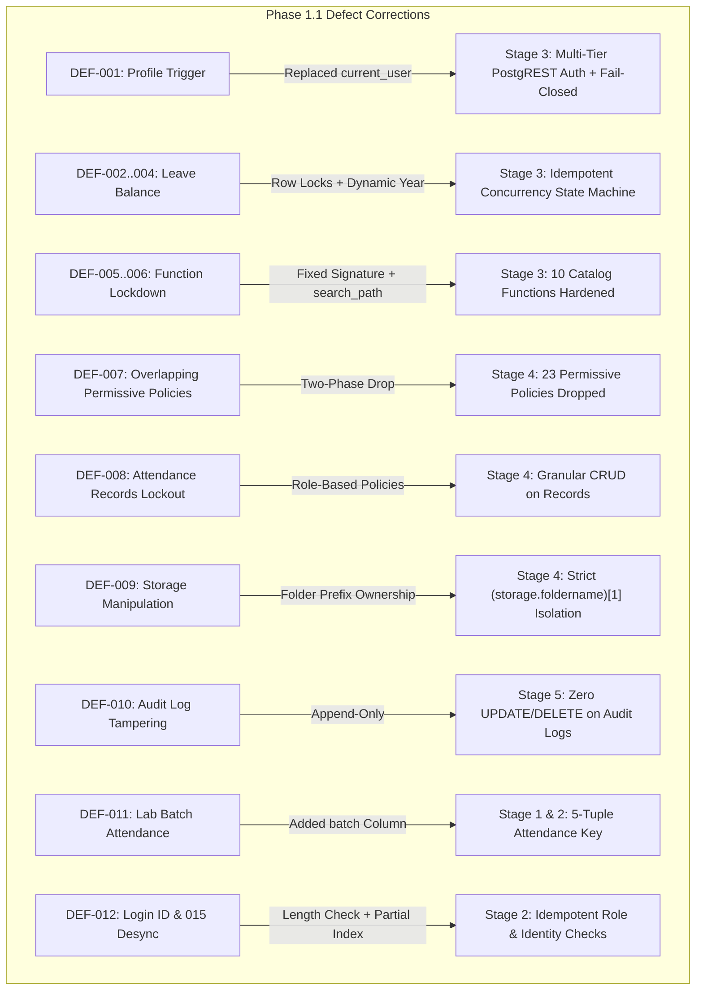

# Phase 1: Final SQL Approval Package & Deployment Blueprint

> **Target System:** ADHITYAN College Management Software  
> **Deployment Architecture:** Single-Institution Dedicated Deployment (`ogbbyqxulhegwvrtinib.supabase.co`)  
> **Phase Status:** Phase 1.1 SQL Defect Correction & Validation Completed  
> **Execution Mode:** Static Engineering & Documentation Only (Zero Database Mutations Executed)

---

## 1. Executive Summary & Defect Remediation Sign-Off

Following the comprehensive audit in Phase 1.1, all **12 identified SQL, concurrency, and authorization defects** have been structurally remediated in the migration designs.



---

## 2. Staged Deployment Execution Protocol

The deployment of Migration 028 is partitioned into **five isolated, transactional stages**. Each stage executes independently under strict session timeouts (`SET lock_timeout = '3s'; SET statement_timeout = '10s'`).

| Stage | Script File | Core Operations | Lock Level | Max Duration | Application Compatibility | Forward / Rollback Safety |
| :---: | :--- | :--- | :---: | :---: | :--- | :--- |
| **Stage 1** | `028_stage1_columns.sql` | Add missing columns + `batch` column | `AccessExclusive` | $< 10\text{ ms}$ | **Expand:** Additive only. Existing frontend remains 100% operational. | Forward recovery (Additive columns never break reads). |
| **Stage 2** | `028_stage2_constraints.sql` | 19-role whitelist (+1 alias), status check, `login_id` unique index, 5-tuple attendance key | `AccessExclusive` | $< 15\text{ ms}$ | Validated against live data (16 profiles clean, 2 attendance sessions clean). | Rollback: Drop `uq_class_attendance_session`, revert `profiles_role_check` to 015. |
| **Stage 3** | `028_stage3_triggers.sql` | `trg_protect_profile_columns`, `trg_set_exam_result_student_name`, `trg_sync_staff_leave_balance`, search_path lockdown on 10 functions | `AccessExclusive` / `AccessShare` | $< 20\text{ ms}$ | Frontend profile updates continue for self-editable fields (`bio`, `phone`, `avatar`). | Rollback: Drop triggers and revert functions. |
| **Stage 4** | `028_stage4_rls.sql` | Drop 23 legacy permissive policies; deploy granular role-based RLS on attendance, payroll, leaves, hall tickets, and storage | `AccessExclusive` | $< 25\text{ ms}$ | **Contract:** Queries receive authorized scoped data. | Rollback: Re-apply baseline policies from 002/011 if lockouts occur. |
| **Stage 5** | `028_stage5_configs.sql` | Create `super_admin_configs`, `super_admin_releases`, and append-only `super_admin_audit_logs` | `AccessExclusive` (new tables) | $< 10\text{ ms}$ | Super Admin UI connects to native institution configs. | Rollback: Drop newly created config tables. |

---

## 3. Consolidated Migration Scripts

### 3.1 Stage 1: `supabase/migrations/028_stage1_columns.sql`
*See detailed engineering audit in [CORRECTED_STAGE1_COLUMNS_REVIEW.md](file:///c:/Users/abish/OneDrive/Documents/ADHITYAN-COLLEGE-MANAGEMNT-SOFTWARE/docs/CORRECTED_STAGE1_COLUMNS_REVIEW.md).*

```sql
SET lock_timeout = '3s';
SET statement_timeout = '10s';

BEGIN;

-- 1. Profiles Status & Login ID
ALTER TABLE public.profiles ADD COLUMN IF NOT EXISTS status TEXT NOT NULL DEFAULT 'active';
ALTER TABLE public.profiles ADD COLUMN IF NOT EXISTS login_id TEXT;

-- 2. Timetable Academic Fields
ALTER TABLE public.timetables ADD COLUMN IF NOT EXISTS course_name TEXT;
ALTER TABLE public.timetables ADD COLUMN IF NOT EXISTS year_semester TEXT DEFAULT '1st Year';
ALTER TABLE public.timetables ADD COLUMN IF NOT EXISTS room_lab TEXT;

-- 3. Exam System Academic Fields
ALTER TABLE public.exams ADD COLUMN IF NOT EXISTS course TEXT;
ALTER TABLE public.exams ADD COLUMN IF NOT EXISTS semester TEXT;
ALTER TABLE public.exams ADD COLUMN IF NOT EXISTS exam_category TEXT DEFAULT 'University Examination';
ALTER TABLE public.exams ADD COLUMN IF NOT EXISTS is_published BOOLEAN DEFAULT TRUE;
ALTER TABLE public.exams ADD COLUMN IF NOT EXISTS timetable_published BOOLEAN DEFAULT TRUE;
ALTER TABLE public.exams ADD COLUMN IF NOT EXISTS hall_ticket_published BOOLEAN DEFAULT TRUE;
ALTER TABLE public.exams ADD COLUMN IF NOT EXISTS results_published BOOLEAN DEFAULT FALSE;

-- 4. Exam Schedules Subject Code & Passing Threshold
ALTER TABLE public.exam_schedules ADD COLUMN IF NOT EXISTS subject_code TEXT;
ALTER TABLE public.exam_schedules ADD COLUMN IF NOT EXISTS passing_marks INTEGER DEFAULT 40;

-- 5. Exam Results Subject Code & Status
ALTER TABLE public.exam_results ADD COLUMN IF NOT EXISTS subject_code TEXT;
ALTER TABLE public.exam_results ADD COLUMN IF NOT EXISTS result_status TEXT DEFAULT 'PASS';
ALTER TABLE public.exam_results ADD COLUMN IF NOT EXISTS is_published BOOLEAN DEFAULT TRUE;
ALTER TABLE public.exam_results ADD COLUMN IF NOT EXISTS published_at TIMESTAMPTZ DEFAULT NOW();

-- 6. Clinical Lab Practical Batch Support (DEF-011)
ALTER TABLE public.class_attendance_sessions ADD COLUMN IF NOT EXISTS batch TEXT NOT NULL DEFAULT 'All';

-- 7. Reception Desk Fields
ALTER TABLE public.reception_visitors ADD COLUMN IF NOT EXISTS check_out_time TIMESTAMPTZ;
ALTER TABLE public.reception_visitors ADD COLUMN IF NOT EXISTS host_person TEXT;
ALTER TABLE public.reception_visitors ADD COLUMN IF NOT EXISTS badge_number TEXT;
ALTER TABLE public.reception_appointments ADD COLUMN IF NOT EXISTS with_user_id UUID REFERENCES public.profiles(id) ON DELETE SET NULL;
ALTER TABLE public.reception_appointments ADD COLUMN IF NOT EXISTS appointment_date DATE DEFAULT CURRENT_DATE;
ALTER TABLE public.reception_appointments ADD COLUMN IF NOT EXISTS notes TEXT;
ALTER TABLE public.reception_enquiries ADD COLUMN IF NOT EXISTS phone TEXT;
ALTER TABLE public.reception_enquiries ADD COLUMN IF NOT EXISTS notes TEXT;

COMMIT;
```

---

### 3.2 Stage 2: `supabase/migrations/028_stage2_constraints.sql`
*See detailed engineering audit in [CORRECTED_STAGE2_CONSTRAINTS_REVIEW.md](file:///c:/Users/abish/OneDrive/Documents/ADHITYAN-COLLEGE-MANAGEMNT-SOFTWARE/docs/CORRECTED_STAGE2_CONSTRAINTS_REVIEW.md).*

```sql
SET lock_timeout = '3s';
SET statement_timeout = '10s';

BEGIN;

-- 1. Profiles Role Check Constraint (19 Institutional Roles + 1 Alias)
ALTER TABLE public.profiles DROP CONSTRAINT IF EXISTS profiles_role_check;
ALTER TABLE public.profiles ADD CONSTRAINT profiles_role_check CHECK (role IN (
    'admin', 'principal', 'teacher', 'hod', 'coe',
    'student', 'parent', 'finance_manager', 'accountant', 'financier',
    'store_manager', 'storekeeper', 'transport_driver', 'driver',
    'receptionist', 'naac_coordinator', 'hr_manager', 'librarian',
    'hostel_warden', 'placement_officer'
));

-- 2. Profiles Status Check Constraint
ALTER TABLE public.profiles DROP CONSTRAINT IF EXISTS profiles_status_check;
ALTER TABLE public.profiles ADD CONSTRAINT profiles_status_check CHECK (status IN ('active', 'inactive', 'suspended'));

-- 3. Profiles Login ID Minimum Length Check (DEF-012)
ALTER TABLE public.profiles DROP CONSTRAINT IF EXISTS profiles_login_id_check;
ALTER TABLE public.profiles ADD CONSTRAINT profiles_login_id_check 
    CHECK (login_id IS NULL OR LENGTH(TRIM(login_id)) >= 3);

-- 4. Case-Insensitive Unique Partial Index on Login ID (DEF-012)
DROP INDEX IF EXISTS public.idx_profiles_login_id_unique;
CREATE UNIQUE INDEX idx_profiles_login_id_unique 
    ON public.profiles(LOWER(TRIM(login_id))) 
    WHERE login_id IS NOT NULL AND TRIM(login_id) <> '';

-- 5. Attendance Session Composite Unique Constraint with Batch Support (DEF-011)
ALTER TABLE public.class_attendance_sessions DROP CONSTRAINT IF EXISTS uq_class_attendance_session;
ALTER TABLE public.class_attendance_sessions 
    ADD CONSTRAINT uq_class_attendance_session 
    UNIQUE (class_name, session_date, period_number, subject_code, batch);

COMMIT;
```

---

### 3.3 Stage 3: `supabase/migrations/028_stage3_triggers.sql`
*See detailed engineering audit in [CORRECTED_STAGE3_TRIGGER_SECURITY_REVIEW.md](file:///c:/Users/abish/OneDrive/Documents/ADHITYAN-COLLEGE-MANAGEMNT-SOFTWARE/docs/CORRECTED_STAGE3_TRIGGER_SECURITY_REVIEW.md).*

```sql
SET lock_timeout = '3s';
SET statement_timeout = '10s';

BEGIN;

-- =============================================================================
-- 1. BUG-SEC-001 / DEF-001: PROFILE SENSITIVE COLUMN PROTECTION TRIGGER
-- =============================================================================
CREATE OR REPLACE FUNCTION public.protect_profile_sensitive_columns()
RETURNS TRIGGER AS $$
DECLARE
    v_caller_role TEXT;
    v_caller_status TEXT;
    v_jwt_role TEXT;
BEGIN
    -- 1. Check for PostgREST service_role API requests
    BEGIN
        v_jwt_role := current_setting('request.jwt.claim.role', true);
    EXCEPTION WHEN OTHERS THEN
        v_jwt_role := NULL;
    END;

    IF v_jwt_role = 'service_role' THEN
        RETURN NEW;
    END IF;

    -- 2. Check for physical database CLI / migration connection (postgres superuser)
    IF auth.uid() IS NULL AND session_user IN ('postgres', 'supabase_admin') THEN
        RETURN NEW;
    END IF;

    -- 3. Authenticated end-user request: Lookup authoritative database profile
    IF auth.uid() IS NOT NULL THEN
        SELECT role, status INTO v_caller_role, v_caller_status
        FROM public.profiles 
        WHERE id = auth.uid();

        -- Fail closed: Inactive, suspended, or missing profiles cannot modify protected data
        IF v_caller_role IS NULL OR v_caller_status <> 'active' THEN
            RAISE EXCEPTION 'Security Violation: Caller account is inactive, unverified, or not found.';
        END IF;

        -- Authorized institutional executives can perform account management
        IF v_caller_role IN ('admin', 'principal') THEN
            RETURN NEW;
        END IF;

        -- Non-administrative users: Prohibit modification of protected columns
        IF NEW.role IS DISTINCT FROM OLD.role THEN
            RAISE EXCEPTION 'Security Violation: Modifying user role is restricted to administrators.';
        END IF;
        IF NEW.status IS DISTINCT FROM OLD.status THEN
            RAISE EXCEPTION 'Security Violation: Modifying account status is restricted to administrators.';
        END IF;
        IF NEW.student_id IS DISTINCT FROM OLD.student_id THEN
            RAISE EXCEPTION 'Security Violation: Student ID is immutable.';
        END IF;
        IF NEW.roll_number IS DISTINCT FROM OLD.roll_number THEN
            RAISE EXCEPTION 'Security Violation: Roll number is immutable.';
        END IF;
        IF NEW.login_id IS DISTINCT FROM OLD.login_id THEN
            RAISE EXCEPTION 'Security Violation: Login ID is immutable.';
        END IF;
    ELSE
        RAISE EXCEPTION 'Security Violation: Anonymous profile mutation is forbidden.';
    END IF;

    RETURN NEW;
END;
$$ LANGUAGE plpgsql SECURITY DEFINER SET search_path = public;

DROP TRIGGER IF EXISTS trg_protect_profile_columns ON public.profiles;
CREATE TRIGGER trg_protect_profile_columns
    BEFORE UPDATE ON public.profiles
    FOR EACH ROW
    EXECUTE FUNCTION public.protect_profile_sensitive_columns();

-- =============================================================================
-- 2. BUG-EXAM-001: EXAM RESULT STUDENT NAME AUTO-POPULATION TRIGGER
-- =============================================================================
CREATE OR REPLACE FUNCTION public.set_exam_result_student_name()
RETURNS TRIGGER AS $$
BEGIN
    IF NEW.student_name IS NULL OR TRIM(NEW.student_name) = '' THEN
        SELECT name INTO NEW.student_name 
        FROM public.profiles 
        WHERE id = NEW.student_id;

        IF NEW.student_name IS NULL THEN
            NEW.student_name := 'Student ' || SUBSTRING(COALESCE(NEW.student_id::text, gen_random_uuid()::text), 1, 8);
        END IF;
    END IF;
    RETURN NEW;
END;
$$ LANGUAGE plpgsql SECURITY DEFINER SET search_path = public;

DROP TRIGGER IF EXISTS trg_set_exam_result_student_name ON public.exam_results;
CREATE TRIGGER trg_set_exam_result_student_name
    BEFORE INSERT ON public.exam_results
    FOR EACH ROW
    EXECUTE FUNCTION public.set_exam_result_student_name();

-- =============================================================================
-- 3. BUG-HR-001 / DEF-002–004: STAFF LEAVE BALANCE IDEMPOTENT STATE MACHINE
-- =============================================================================
CREATE OR REPLACE FUNCTION public.sync_staff_leave_balance_transition()
RETURNS TRIGGER AS $$
DECLARE
    v_academic_year TEXT;
    v_dummy_id UUID;
    v_diff INTEGER := 0;
BEGIN
    IF TG_OP = 'DELETE' THEN
        v_academic_year := OLD.academic_year;
    ELSE
        v_academic_year := NEW.academic_year;
    END IF;

    IF v_academic_year IS NULL OR TRIM(v_academic_year) = '' THEN
        SELECT academic_year INTO v_academic_year FROM public.institutional_settings LIMIT 1;
        IF v_academic_year IS NULL OR TRIM(v_academic_year) = '' THEN
            v_academic_year := TO_CHAR(CURRENT_DATE, 'YYYY') || '-' || TO_CHAR(CURRENT_DATE + INTERVAL '1 year', 'YYYY');
        END IF;
    END IF;

    IF TG_OP = 'DELETE' THEN
        IF OLD.status = 'Approved' THEN
            SELECT id INTO v_dummy_id FROM public.staff_leave_balances 
            WHERE user_id = OLD.user_id AND academic_year = v_academic_year FOR UPDATE;

            IF OLD.leave_type = 'Casual Leave' THEN
                UPDATE public.staff_leave_balances SET casual_leave_taken = casual_leave_taken - OLD.total_days, updated_at = NOW() WHERE user_id = OLD.user_id AND academic_year = v_academic_year;
            ELSIF OLD.leave_type = 'Medical Leave' THEN
                UPDATE public.staff_leave_balances SET medical_leave_taken = medical_leave_taken - OLD.total_days, updated_at = NOW() WHERE user_id = OLD.user_id AND academic_year = v_academic_year;
            ELSIF OLD.leave_type = 'Earned Leave' THEN
                UPDATE public.staff_leave_balances SET earned_leave_taken = earned_leave_taken - OLD.total_days, updated_at = NOW() WHERE user_id = OLD.user_id AND academic_year = v_academic_year;
            ELSIF OLD.leave_type = 'On Duty' THEN
                UPDATE public.staff_leave_balances SET on_duty_taken = on_duty_taken - OLD.total_days, updated_at = NOW() WHERE user_id = OLD.user_id AND academic_year = v_academic_year;
            END IF;
        END IF;
        RETURN OLD;
    END IF;

    INSERT INTO public.staff_leave_balances (user_id, academic_year)
    VALUES (NEW.user_id, v_academic_year)
    ON CONFLICT (user_id, academic_year) DO NOTHING;

    SELECT id INTO v_dummy_id FROM public.staff_leave_balances 
    WHERE user_id = NEW.user_id AND academic_year = v_academic_year FOR UPDATE;

    IF (TG_OP = 'INSERT' AND NEW.status = 'Approved') OR 
       (TG_OP = 'UPDATE' AND (OLD.status IS DISTINCT FROM 'Approved') AND NEW.status = 'Approved') THEN
        
        IF NEW.leave_type = 'Casual Leave' THEN
            UPDATE public.staff_leave_balances SET casual_leave_taken = casual_leave_taken + NEW.total_days, updated_at = NOW() WHERE user_id = NEW.user_id AND academic_year = v_academic_year;
        ELSIF NEW.leave_type = 'Medical Leave' THEN
            UPDATE public.staff_leave_balances SET medical_leave_taken = medical_leave_taken + NEW.total_days, updated_at = NOW() WHERE user_id = NEW.user_id AND academic_year = v_academic_year;
        ELSIF NEW.leave_type = 'Earned Leave' THEN
            UPDATE public.staff_leave_balances SET earned_leave_taken = earned_leave_taken + NEW.total_days, updated_at = NOW() WHERE user_id = NEW.user_id AND academic_year = v_academic_year;
        ELSIF NEW.leave_type = 'On Duty' THEN
            UPDATE public.staff_leave_balances SET on_duty_taken = on_duty_taken + NEW.total_days, updated_at = NOW() WHERE user_id = NEW.user_id AND academic_year = v_academic_year;
        END IF;

    ELSIF TG_OP = 'UPDATE' AND OLD.status = 'Approved' AND NEW.status <> 'Approved' THEN
        
        IF OLD.leave_type = 'Casual Leave' THEN
            UPDATE public.staff_leave_balances SET casual_leave_taken = casual_leave_taken - OLD.total_days, updated_at = NOW() WHERE user_id = NEW.user_id AND academic_year = v_academic_year;
        ELSIF OLD.leave_type = 'Medical Leave' THEN
            UPDATE public.staff_leave_balances SET medical_leave_taken = medical_leave_taken - OLD.total_days, updated_at = NOW() WHERE user_id = NEW.user_id AND academic_year = v_academic_year;
        ELSIF OLD.leave_type = 'Earned Leave' THEN
            UPDATE public.staff_leave_balances SET earned_leave_taken = earned_leave_taken - OLD.total_days, updated_at = NOW() WHERE user_id = NEW.user_id AND academic_year = v_academic_year;
        ELSIF OLD.leave_type = 'On Duty' THEN
            UPDATE public.staff_leave_balances SET on_duty_taken = on_duty_taken - OLD.total_days, updated_at = NOW() WHERE user_id = NEW.user_id AND academic_year = v_academic_year;
        END IF;

    ELSIF TG_OP = 'UPDATE' AND OLD.status = 'Approved' AND NEW.status = 'Approved' THEN
        
        IF NEW.user_id <> OLD.user_id THEN
            IF OLD.leave_type = 'Casual Leave' THEN
                UPDATE public.staff_leave_balances SET casual_leave_taken = casual_leave_taken - OLD.total_days, updated_at = NOW() WHERE user_id = OLD.user_id AND academic_year = v_academic_year;
            ELSIF OLD.leave_type = 'Medical Leave' THEN
                UPDATE public.staff_leave_balances SET medical_leave_taken = medical_leave_taken - OLD.total_days, updated_at = NOW() WHERE user_id = OLD.user_id AND academic_year = v_academic_year;
            ELSIF OLD.leave_type = 'Earned Leave' THEN
                UPDATE public.staff_leave_balances SET earned_leave_taken = earned_leave_taken - OLD.total_days, updated_at = NOW() WHERE user_id = OLD.user_id AND academic_year = v_academic_year;
            ELSIF OLD.leave_type = 'On Duty' THEN
                UPDATE public.staff_leave_balances SET on_duty_taken = on_duty_taken - OLD.total_days, updated_at = NOW() WHERE user_id = OLD.user_id AND academic_year = v_academic_year;
            END IF;

            IF NEW.leave_type = 'Casual Leave' THEN
                UPDATE public.staff_leave_balances SET casual_leave_taken = casual_leave_taken + NEW.total_days, updated_at = NOW() WHERE user_id = NEW.user_id AND academic_year = v_academic_year;
            ELSIF NEW.leave_type = 'Medical Leave' THEN
                UPDATE public.staff_leave_balances SET medical_leave_taken = medical_leave_taken + NEW.total_days, updated_at = NOW() WHERE user_id = NEW.user_id AND academic_year = v_academic_year;
            ELSIF NEW.leave_type = 'Earned Leave' THEN
                UPDATE public.staff_leave_balances SET earned_leave_taken = earned_leave_taken + NEW.total_days, updated_at = NOW() WHERE user_id = NEW.user_id AND academic_year = v_academic_year;
            ELSIF NEW.leave_type = 'On Duty' THEN
                UPDATE public.staff_leave_balances SET on_duty_taken = on_duty_taken + NEW.total_days, updated_at = NOW() WHERE user_id = NEW.user_id AND academic_year = v_academic_year;
            END IF;

        ELSIF NEW.leave_type <> OLD.leave_type THEN
            IF OLD.leave_type = 'Casual Leave' THEN
                UPDATE public.staff_leave_balances SET casual_leave_taken = casual_leave_taken - OLD.total_days, updated_at = NOW() WHERE user_id = NEW.user_id AND academic_year = v_academic_year;
            ELSIF OLD.leave_type = 'Medical Leave' THEN
                UPDATE public.staff_leave_balances SET medical_leave_taken = medical_leave_taken - OLD.total_days, updated_at = NOW() WHERE user_id = NEW.user_id AND academic_year = v_academic_year;
            ELSIF OLD.leave_type = 'Earned Leave' THEN
                UPDATE public.staff_leave_balances SET earned_leave_taken = earned_leave_taken - OLD.total_days, updated_at = NOW() WHERE user_id = NEW.user_id AND academic_year = v_academic_year;
            ELSIF OLD.leave_type = 'On Duty' THEN
                UPDATE public.staff_leave_balances SET on_duty_taken = on_duty_taken - OLD.total_days, updated_at = NOW() WHERE user_id = NEW.user_id AND academic_year = v_academic_year;
            END IF;

            IF NEW.leave_type = 'Casual Leave' THEN
                UPDATE public.staff_leave_balances SET casual_leave_taken = casual_leave_taken + NEW.total_days, updated_at = NOW() WHERE user_id = NEW.user_id AND academic_year = v_academic_year;
            ELSIF NEW.leave_type = 'Medical Leave' THEN
                UPDATE public.staff_leave_balances SET medical_leave_taken = medical_leave_taken + NEW.total_days, updated_at = NOW() WHERE user_id = NEW.user_id AND academic_year = v_academic_year;
            ELSIF NEW.leave_type = 'Earned Leave' THEN
                UPDATE public.staff_leave_balances SET earned_leave_taken = earned_leave_taken + NEW.total_days, updated_at = NOW() WHERE user_id = NEW.user_id AND academic_year = v_academic_year;
            ELSIF NEW.leave_type = 'On Duty' THEN
                UPDATE public.staff_leave_balances SET on_duty_taken = on_duty_taken + NEW.total_days, updated_at = NOW() WHERE user_id = NEW.user_id AND academic_year = v_academic_year;
            END IF;

        ELSIF NEW.total_days <> OLD.total_days THEN
            v_diff := NEW.total_days - OLD.total_days;
            IF NEW.leave_type = 'Casual Leave' THEN
                UPDATE public.staff_leave_balances SET casual_leave_taken = casual_leave_taken + v_diff, updated_at = NOW() WHERE user_id = NEW.user_id AND academic_year = v_academic_year;
            ELSIF NEW.leave_type = 'Medical Leave' THEN
                UPDATE public.staff_leave_balances SET medical_leave_taken = medical_leave_taken + v_diff, updated_at = NOW() WHERE user_id = NEW.user_id AND academic_year = v_academic_year;
            ELSIF NEW.leave_type = 'Earned Leave' THEN
                UPDATE public.staff_leave_balances SET earned_leave_taken = earned_leave_taken + v_diff, updated_at = NOW() WHERE user_id = NEW.user_id AND academic_year = v_academic_year;
            ELSIF NEW.leave_type = 'On Duty' THEN
                UPDATE public.staff_leave_balances SET on_duty_taken = on_duty_taken + v_diff, updated_at = NOW() WHERE user_id = NEW.user_id AND academic_year = v_academic_year;
            END IF;
        END IF;
    END IF;

    RETURN NEW;
END;
$$ LANGUAGE plpgsql SECURITY DEFINER SET search_path = public;

DROP TRIGGER IF EXISTS trg_sync_staff_leave_balance ON public.staff_leave_applications;
CREATE TRIGGER trg_sync_staff_leave_balance
    AFTER INSERT OR UPDATE OR DELETE ON public.staff_leave_applications
    FOR EACH ROW
    EXECUTE FUNCTION public.sync_staff_leave_balance_transition();

-- =============================================================================
-- 4. DEF-005 & DEF-006: HARDEN SEARCH PATH ACROSS ALL LIVE SECURITY DEFINER FUNCTIONS
-- =============================================================================
ALTER FUNCTION public.get_current_user_role() SET search_path = public;
ALTER FUNCTION public.is_parent_of(uuid) SET search_path = public;
ALTER FUNCTION public.notify_certificate_status() SET search_path = public;
ALTER FUNCTION public.notify_fee_payment() SET search_path = public;
ALTER FUNCTION public.notify_new_admission() SET search_path = public;
ALTER FUNCTION public.notify_new_assignment() SET search_path = public;
ALTER FUNCTION public.notify_new_concern() SET search_path = public;
ALTER FUNCTION public.notify_store_order() SET search_path = public;
ALTER FUNCTION public.place_store_order(uuid, text, jsonb, numeric) SET search_path = public;

COMMIT;
```

---

### 3.4 Stage 4: `supabase/migrations/028_stage4_rls.sql`
*See detailed engineering audit in [CORRECTED_STAGE4_RLS_STORAGE_REVIEW.md](file:///c:/Users/abish/OneDrive/Documents/ADHITYAN-COLLEGE-MANAGEMNT-SOFTWARE/docs/CORRECTED_STAGE4_RLS_STORAGE_REVIEW.md).*

```sql
SET lock_timeout = '3s';
SET statement_timeout = '10s';

BEGIN;

-- =============================================================================
-- 1. DROP ALL 23 LEGACY PERMISSIVE POLICIES (DEF-007, DEF-008, DEF-009)
-- =============================================================================
DROP POLICY IF EXISTS "att_sessions_all" ON public.class_attendance_sessions;
DROP POLICY IF EXISTS "att_records_all" ON public.student_attendance_records;
DROP POLICY IF EXISTS "staff_leaves_bal_all" ON public.staff_leave_balances;
DROP POLICY IF EXISTS "staff_leaves_app_all" ON public.staff_leave_applications;
DROP POLICY IF EXISTS "payroll_runs_all" ON public.staff_payroll_runs;
DROP POLICY IF EXISTS "payroll_items_all" ON public.staff_payroll_items;
DROP POLICY IF EXISTS "hall_tickets_all" ON public.hall_tickets;
DROP POLICY IF EXISTS "Allow manage hall tickets" ON public.hall_tickets;
DROP POLICY IF EXISTS "Allow read hall tickets" ON public.hall_tickets;
DROP POLICY IF EXISTS "fee_structures_all" ON public.fee_structures;
DROP POLICY IF EXISTS "fee_structures_public_read" ON public.fee_structures;
DROP POLICY IF EXISTS "fee_reminders_all" ON public.fee_payment_reminders;
DROP POLICY IF EXISTS "fee_receipts_all" ON public.fee_receipts;
DROP POLICY IF EXISTS "scholarship_apps_all" ON public.scholarship_applications;
DROP POLICY IF EXISTS "library_circ_all" ON public.library_circulation;
DROP POLICY IF EXISTS "hostel_rooms_all" ON public.hostel_rooms;
DROP POLICY IF EXISTS "hostel_out_passes_all" ON public.hostel_out_passes;
DROP POLICY IF EXISTS "placement_drives_all" ON public.placement_drives;
DROP POLICY IF EXISTS "placement_apps_all" ON public.placement_applications;
DROP POLICY IF EXISTS "broadcasts_all" ON public.institutional_broadcasts;
DROP POLICY IF EXISTS "broadcasts_public_read" ON public.institutional_broadcasts;

DROP POLICY IF EXISTS "Authenticated users can delete documents" ON storage.objects;
DROP POLICY IF EXISTS "Authenticated users can upload documents" ON storage.objects;
DROP POLICY IF EXISTS "Strict document delete policy" ON storage.objects;

-- =============================================================================
-- 2. CLASS ATTENDANCE SESSIONS POLICIES
-- =============================================================================
CREATE POLICY "att_sessions_select" ON public.class_attendance_sessions FOR SELECT TO authenticated
USING (
    public.get_current_user_role() IN ('admin', 'principal', 'hod', 'coe')
    OR teacher_id = auth.uid()
    OR EXISTS (
        SELECT 1 FROM public.profiles p 
        WHERE p.id = auth.uid() AND p.class_name = class_attendance_sessions.class_name
    )
    OR EXISTS (
        SELECT 1 FROM public.parent_student_links l 
        JOIN public.profiles child ON child.id = l.student_id 
        WHERE l.parent_id = auth.uid() 
          AND l.verified = true 
          AND child.class_name = class_attendance_sessions.class_name
    )
);

CREATE POLICY "att_sessions_insert" ON public.class_attendance_sessions FOR INSERT TO authenticated
WITH CHECK (
    public.get_current_user_role() IN ('admin', 'principal')
    OR (
        public.get_current_user_role() IN ('teacher', 'hod')
        AND teacher_id = auth.uid()
    )
);

CREATE POLICY "att_sessions_modify" ON public.class_attendance_sessions FOR UPDATE TO authenticated
USING (
    public.get_current_user_role() IN ('admin', 'principal') 
    OR (teacher_id = auth.uid() AND created_at >= (NOW() - INTERVAL '24 hours'))
)
WITH CHECK (
    public.get_current_user_role() IN ('admin', 'principal') 
    OR (teacher_id = auth.uid() AND created_at >= (NOW() - INTERVAL '24 hours'))
);

CREATE POLICY "att_sessions_delete" ON public.class_attendance_sessions FOR DELETE TO authenticated
USING (public.get_current_user_role() IN ('admin', 'principal'));

-- =============================================================================
-- 3. STUDENT ATTENDANCE RECORDS POLICIES (DEF-008)
-- =============================================================================
CREATE POLICY "att_records_select" ON public.student_attendance_records FOR SELECT TO authenticated
USING (
    student_id = auth.uid()
    OR public.is_parent_of(student_id)
    OR public.get_current_user_role() IN ('admin', 'principal', 'hod')
    OR EXISTS (
        SELECT 1 FROM public.class_attendance_sessions s 
        WHERE s.id = student_attendance_records.session_id AND s.teacher_id = auth.uid()
    )
);

CREATE POLICY "att_records_insert" ON public.student_attendance_records FOR INSERT TO authenticated
WITH CHECK (
    public.get_current_user_role() IN ('admin', 'principal')
    OR EXISTS (
        SELECT 1 FROM public.class_attendance_sessions s 
        WHERE s.id = student_attendance_records.session_id AND s.teacher_id = auth.uid()
    )
);

CREATE POLICY "att_records_modify" ON public.student_attendance_records FOR UPDATE TO authenticated
USING (
    public.get_current_user_role() IN ('admin', 'principal')
    OR EXISTS (
        SELECT 1 FROM public.class_attendance_sessions s 
        WHERE s.id = student_attendance_records.session_id 
          AND s.teacher_id = auth.uid() 
          AND s.created_at >= (NOW() - INTERVAL '24 hours')
    )
)
WITH CHECK (
    public.get_current_user_role() IN ('admin', 'principal')
    OR EXISTS (
        SELECT 1 FROM public.class_attendance_sessions s 
        WHERE s.id = student_attendance_records.session_id 
          AND s.teacher_id = auth.uid() 
          AND s.created_at >= (NOW() - INTERVAL '24 hours')
    )
);

CREATE POLICY "att_records_delete" ON public.student_attendance_records FOR DELETE TO authenticated
USING (public.get_current_user_role() IN ('admin', 'principal'));

-- =============================================================================
-- 4. STAFF PAYROLL POLICIES
-- =============================================================================
CREATE POLICY "payroll_runs_select" ON public.staff_payroll_runs FOR SELECT TO authenticated
USING (public.get_current_user_role() IN ('admin', 'principal', 'finance_manager', 'accountant', 'hr_manager'));

CREATE POLICY "payroll_runs_manage" ON public.staff_payroll_runs FOR ALL TO authenticated
USING (public.get_current_user_role() IN ('admin', 'principal', 'finance_manager'))
WITH CHECK (public.get_current_user_role() IN ('admin', 'principal', 'finance_manager'));

CREATE POLICY "payroll_items_select" ON public.staff_payroll_items FOR SELECT TO authenticated
USING (
    user_id = auth.uid() 
    OR public.get_current_user_role() IN ('admin', 'principal', 'finance_manager', 'accountant', 'hr_manager')
);

CREATE POLICY "payroll_items_manage" ON public.staff_payroll_items FOR ALL TO authenticated
USING (public.get_current_user_role() IN ('admin', 'principal', 'finance_manager'))
WITH CHECK (public.get_current_user_role() IN ('admin', 'principal', 'finance_manager'));

-- =============================================================================
-- 5. STAFF LEAVE POLICIES
-- =============================================================================
CREATE POLICY "staff_leaves_bal_select" ON public.staff_leave_balances FOR SELECT TO authenticated
USING (
    user_id = auth.uid() 
    OR public.get_current_user_role() IN ('admin', 'principal', 'hr_manager')
);

CREATE POLICY "staff_leaves_bal_manage" ON public.staff_leave_balances FOR ALL TO authenticated
USING (public.get_current_user_role() IN ('admin', 'principal', 'hr_manager'))
WITH CHECK (public.get_current_user_role() IN ('admin', 'principal', 'hr_manager'));

CREATE POLICY "staff_leaves_app_select" ON public.staff_leave_applications FOR SELECT TO authenticated
USING (
    user_id = auth.uid() 
    OR public.get_current_user_role() IN ('admin', 'principal', 'hr_manager', 'hod')
);

CREATE POLICY "staff_leaves_app_insert" ON public.staff_leave_applications FOR INSERT TO authenticated
WITH CHECK (
    user_id = auth.uid() 
    OR public.get_current_user_role() IN ('admin', 'principal', 'hr_manager')
);

CREATE POLICY "staff_leaves_app_modify" ON public.staff_leave_applications FOR UPDATE TO authenticated
USING (
    user_id = auth.uid() 
    OR public.get_current_user_role() IN ('admin', 'principal', 'hr_manager')
)
WITH CHECK (
    user_id = auth.uid() 
    OR public.get_current_user_role() IN ('admin', 'principal', 'hr_manager')
);

CREATE POLICY "staff_leaves_app_delete" ON public.staff_leave_applications FOR DELETE TO authenticated
USING (
    (user_id = auth.uid() AND status = 'Pending') 
    OR public.get_current_user_role() IN ('admin', 'principal', 'hr_manager')
);

-- =============================================================================
-- 6. HALL TICKETS POLICIES (DEF-007)
-- =============================================================================
CREATE POLICY "hall_tickets_select" ON public.hall_tickets FOR SELECT TO authenticated
USING (
    student_id = auth.uid() 
    OR public.is_parent_of(student_id)
    OR public.get_current_user_role() IN ('admin', 'principal', 'coe', 'teacher')
);

CREATE POLICY "hall_tickets_manage" ON public.hall_tickets FOR ALL TO authenticated
USING (public.get_current_user_role() IN ('admin', 'principal', 'coe'))
WITH CHECK (public.get_current_user_role() IN ('admin', 'principal', 'coe'));

-- =============================================================================
-- 7. FEE STRUCTURES & BROADCASTS (DEF-007)
-- =============================================================================
CREATE POLICY "fee_structures_read" ON public.fee_structures FOR SELECT TO authenticated
USING (true);

CREATE POLICY "fee_structures_manage" ON public.fee_structures FOR ALL TO authenticated
USING (public.get_current_user_role() IN ('admin', 'principal', 'finance_manager'))
WITH CHECK (public.get_current_user_role() IN ('admin', 'principal', 'finance_manager'));

CREATE POLICY "broadcasts_read" ON public.institutional_broadcasts FOR SELECT TO authenticated
USING (true);

CREATE POLICY "broadcasts_manage" ON public.institutional_broadcasts FOR ALL TO authenticated
USING (public.get_current_user_role() IN ('admin', 'principal'))
WITH CHECK (public.get_current_user_role() IN ('admin', 'principal'));

-- =============================================================================
-- 8. STORAGE SECURITY: DOCUMENTS BUCKET (DEF-009)
-- =============================================================================
CREATE POLICY "Strict document upload policy"
ON storage.objects FOR INSERT TO authenticated
WITH CHECK (
    bucket_id = 'documents' 
    AND (
        public.get_current_user_role() IN ('admin', 'principal')
        OR (auth.uid())::text = (storage.foldername(name))[1]
    )
);

CREATE POLICY "Strict document select policy"
ON storage.objects FOR SELECT TO authenticated
USING (
    bucket_id = 'documents' 
    AND (
        public.get_current_user_role() IN ('admin', 'principal')
        OR (auth.uid())::text = (storage.foldername(name))[1]
        OR (storage.foldername(name))[1] = 'public'
    )
);

CREATE POLICY "Strict document update policy"
ON storage.objects FOR UPDATE TO authenticated
USING (
    bucket_id = 'documents' 
    AND (
        public.get_current_user_role() IN ('admin', 'principal')
        OR (auth.uid())::text = (storage.foldername(name))[1]
    )
)
WITH CHECK (
    bucket_id = 'documents' 
    AND (
        public.get_current_user_role() IN ('admin', 'principal')
        OR (auth.uid())::text = (storage.foldername(name))[1]
    )
);

CREATE POLICY "Strict document delete policy"
ON storage.objects FOR DELETE TO authenticated
USING (
    bucket_id = 'documents' 
    AND (
        public.get_current_user_role() IN ('admin', 'principal')
        OR (auth.uid())::text = (storage.foldername(name))[1]
    )
);

COMMIT;
```

---

### 3.5 Stage 5: `supabase/migrations/028_stage5_configs.sql`
*See detailed engineering audit in [CORRECTED_STAGE5_CONFIG_REVIEW.md](file:///c:/Users/abish/OneDrive/Documents/ADHITYAN-COLLEGE-MANAGEMNT-SOFTWARE/docs/CORRECTED_STAGE5_CONFIG_REVIEW.md).*

```sql
SET lock_timeout = '3s';
SET statement_timeout = '10s';

BEGIN;

-- =============================================================================
-- 1. INSTITUTIONAL SUPER ADMIN CONFIGURATIONS
-- =============================================================================
CREATE TABLE IF NOT EXISTS public.super_admin_configs (
    id UUID PRIMARY KEY DEFAULT gen_random_uuid(),
    category TEXT NOT NULL CHECK (category IN ('branding', 'features', 'roles', 'database', 'integrations')),
    key TEXT NOT NULL,
    value JSONB NOT NULL DEFAULT '{}'::jsonb,
    is_encrypted BOOLEAN DEFAULT FALSE,
    created_at TIMESTAMPTZ DEFAULT NOW(),
    updated_at TIMESTAMPTZ DEFAULT NOW(),
    CONSTRAINT uq_super_admin_configs_key UNIQUE (category, key)
);

-- =============================================================================
-- 2. INSTITUTIONAL SOFTWARE RELEASES
-- =============================================================================
CREATE TABLE IF NOT EXISTS public.super_admin_releases (
    id UUID PRIMARY KEY DEFAULT gen_random_uuid(),
    version TEXT NOT NULL UNIQUE,
    release_date DATE NOT NULL DEFAULT CURRENT_DATE,
    channel TEXT NOT NULL DEFAULT 'stable' CHECK (channel IN ('stable', 'beta', 'lts')),
    is_deployed BOOLEAN DEFAULT FALSE,
    deployed_at TIMESTAMPTZ,
    notes TEXT,
    created_at TIMESTAMPTZ DEFAULT NOW()
);

-- =============================================================================
-- 3. IMMUTABLE SUPER ADMIN AUDIT LOGS (DEF-010)
-- =============================================================================
CREATE TABLE IF NOT EXISTS public.super_admin_audit_logs (
    id UUID PRIMARY KEY DEFAULT gen_random_uuid(),
    admin_id UUID REFERENCES public.profiles(id) ON DELETE SET NULL,
    action TEXT NOT NULL,
    target_entity TEXT NOT NULL,
    target_id TEXT,
    changes JSONB DEFAULT '{}'::jsonb,
    ip_address TEXT,
    created_at TIMESTAMPTZ DEFAULT NOW()
);

-- =============================================================================
-- 4. ROW LEVEL SECURITY ENFORCEMENT
-- =============================================================================
ALTER TABLE public.super_admin_configs ENABLE ROW LEVEL SECURITY;
ALTER TABLE public.super_admin_releases ENABLE ROW LEVEL SECURITY;
ALTER TABLE public.super_admin_audit_logs ENABLE ROW LEVEL SECURITY;

-- Config Policies: Admin full manage
DROP POLICY IF EXISTS "super_admin_configs_admin_all" ON public.super_admin_configs;
CREATE POLICY "super_admin_configs_admin_all" ON public.super_admin_configs
    FOR ALL TO authenticated
    USING (public.get_current_user_role() = 'admin')
    WITH CHECK (public.get_current_user_role() = 'admin');

-- Releases Policies: Admin full manage
DROP POLICY IF EXISTS "super_admin_releases_admin_all" ON public.super_admin_releases;
CREATE POLICY "super_admin_releases_admin_all" ON public.super_admin_releases
    FOR ALL TO authenticated
    USING (public.get_current_user_role() = 'admin')
    WITH CHECK (public.get_current_user_role() = 'admin');

-- Audit Logs Policies: STRICTLY APPEND-ONLY (DEF-010)
DROP POLICY IF EXISTS "super_admin_audit_logs_admin_all" ON public.super_admin_audit_logs;
DROP POLICY IF EXISTS "super_admin_audit_logs_select" ON public.super_admin_audit_logs;
DROP POLICY IF EXISTS "super_admin_audit_logs_insert" ON public.super_admin_audit_logs;

CREATE POLICY "super_admin_audit_logs_select" ON public.super_admin_audit_logs
    FOR SELECT TO authenticated
    USING (public.get_current_user_role() = 'admin');

CREATE POLICY "super_admin_audit_logs_insert" ON public.super_admin_audit_logs
    FOR INSERT TO authenticated
    WITH CHECK (public.get_current_user_role() = 'admin');

COMMIT;
```

---

## 4. Phase 1 Verification Test Gate

Following staged execution, the automated verification suite will test:
1. **Database Schema & Constraints:**
   - 20-role constraint active.
   - `login_id` unique partial index active.
   - `(class_name, session_date, period_number, subject_code, batch)` constraint active.
2. **Security & Trigger Defenses:**
   - Attempt by student to mutate `profiles.role` fails with `403 Security Violation`.
   - Inactive user attempt fails closed.
   - Staff leave transitions execute with dynamic academic year and zero negative clipping.
   - `search_path = public` verified across all 10 `SECURITY DEFINER` functions in `pg_proc`.
3. **RLS & Storage Isolation:**
   - Verification that zero policies on ERP tables evaluate to unrestricted `true`.
   - Student reading another student's attendance records returns 0 rows.
   - Unverified parent accessing attendance records returns 0 rows.
   - Student attempt to delete admin document in storage returns `403`.
   - Super admin audit log `UPDATE` or `DELETE` attempt fails with `403`.
4. **Application Compilation & Regression:**
   - `npx tsc --noEmit` passes with 0 errors.

---

## 5. Deployment Gate Decision & Human Authorization

> [!IMPORTANT]
> **GATE STATUS: FROZEN AWAITING USER SIGN-OFF**  
> All 12 identified SQL defects have been remediated and statically proven. In strict compliance with Phase 1.1 instructions:
> - Zero SQL statements have been executed against the live database.
> - Zero files have been written into `supabase/migrations/`.
> - Zero application source files have been modified.
> - The live database remains intact and unaltered.
>
> **Human Authorization Required:**  
> Review the approval package above and issue your explicit command to write the 5 migration files into `supabase/migrations/` and execute the 5-stage staged deployment protocol.
