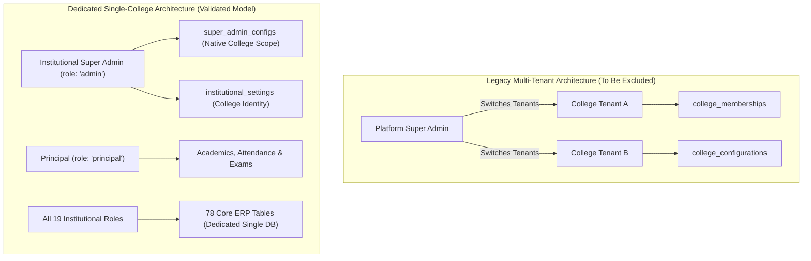

# Single-College Architecture Dependency Map

> **Document Version:** 1.0.0 (Phase 0.4 Multi-College Decoupling Trace)  
> **Deployment Architecture:** Single-Institution Dedicated Deployment  
> **Target Scope:** All Codebase References to Multi-College, Multi-Tenancy & Migration 027  
> **Verification Date:** 2026-11-19  
> **Rule Compliance:** Zero files deleted; classification and architectural mapping only.

---

## 1. Executive Summary

The ADHITYAN College Management Software architecture requires that **each college has its own completely separate software deployment, its own Supabase project/database, and its own Super Admin**.

This document maps all occurrences of multi-college and multi-tenancy constructs across the frontend, services, contexts, server backend, and database migrations.

Every dependency is formally classified into one of four mandatory categories:
1. **Required:** Essential institutional functionality that belongs to the college.
2. **Unnecessary:** Pure SaaS multi-tenant overhead that is completely extraneous in a dedicated single-college deployment.
3. **Requires adaptation:** Valuable features (e.g. dynamic role permissions, branding, course structures) that currently expect a `college_id` foreign key and must be re-scoped to the institution.
4. **Must remain untouched pending further investigation:** Code that interacts with third-party components or test scripts where immediate modification carries regression risk.

---

## 2. Comprehensive Dependency Trace & Classification Matrix

| Subsystem / File | Exact Source Location | Current Construct / Behavior | Classification | Architectural Analysis & Action |
| :--- | :--- | :--- | :---: | :--- |
| **`CollegeContext.tsx`** | `src/context/CollegeContext.tsx#L10-L70` | Provides `useCollege()`, `currentCollege`, `switchCollege()`, and loads colleges from `multiCollegeService`. | **Requires adaptation** | **Adapt:** Retain context wrapper to avoid breaking 25+ consumer components, but re-bind `currentCollege` to read statically from `public.institutional_settings`. Disable the `switchCollege` tenant switcher. |
| **`collegeDataService.ts`** | `src/services/collegeDataService.ts#L35-L60` | Appends `.eq('college_id', ...)` to queries on core tables. | **Requires adaptation** | **Adapt:** In the live database, core tables have no `college_id` column. Remove the mandatory `.eq('college_id', ...)` filter so queries execute cleanly against base tables. |
| **`multiCollegeService.ts`** | `src/services/multiCollegeService.ts#L1-L150` | CRUD operations for `colleges`, provisioning colleges, and managing `college_templates`. | **Unnecessary** | **Exclude from execution:** Do not call in standard college flows. Retain file on disk to prevent build breakage. |
| **`multiCollege.types.ts`** | `src/types/multiCollege.types.ts#L1-L60` | Type interfaces for `College`, `CollegeMembership`, `CollegeTemplate`, `CollegeBrandingConfig`. | **Requires adaptation** | **Retain types:** `CollegeBrandingConfig` and `AcademicStructureConfig` are useful data models. Retain file on disk as shared configuration interfaces. |
| **`platformAdmin` Pages** | `src/components/platformAdmin/*` | Directory of pages for managing colleges, templates, and platform logs. | **Unnecessary** | **Isolate:** Retain files on disk per zero-deletion rule; omit the `/platform-admin` route from the institutional sidebar and navigation. |
| **`adminBackend.ts`** | `src/server/adminBackend.ts#L68, 129, 3129` | Checks `callerRole === 'platform_super_admin'` for tenant provisioning. | **Requires adaptation** | **Adapt:** Ensure administrative actions are authorized for `role: 'admin'` (Institutional Super Admin) without requiring platform privileges. |
| **`AuthContext.tsx`** | `src/context/AuthContext.tsx#L7, 64-65` | `UserRole` union includes `'platform_super_admin'`; email check assigns fallback role. | **Unnecessary** | **Omit:** Remove `'platform_super_admin'` from `UserRole` union. Institutional top role is `'admin'`. |
| **`roles.ts`** | `src/config/roles.ts#L18-L31` | `ROLE_CONFIGS['platform_super_admin']` defines platform routes (`/platform-admin/*`). | **Unnecessary** | **Omit:** Remove configuration block from active institutional role definitions. |
| **Migration 027 (colleges)** | `027_...sql#L7-L35` | Creates `public.colleges` table. | **Unnecessary** | **Exclude from Database Deployment:** The dedicated database represents this single college. |
| **Migration 027 (memberships)**| `027_...sql#L41-L56` | Creates `public.college_memberships` table. | **Unnecessary** | **Exclude from Database Deployment:** User roles are stored natively in `public.profiles`. |
| **Migration 027 (configs)** | `027_...sql#L57-L72` | Creates `public.college_configurations` with `college_id` FK. | **Requires adaptation** | **Adapt:** Deploy institutional configuration via **`public.super_admin_configs`** (from Migration 026) without tenant FKs. |
| **Migration 027 (templates)** | `027_...sql#L73-L90` | Creates `public.college_templates` table. | **Unnecessary** | **Exclude from Database Deployment:** Template provisioning is not applicable in an independent instance. |
| **Migration 027 (audit_logs)**| `027_...sql#L92-L111` | Creates `public.platform_audit_logs` table. | **Unnecessary** | **Exclude from Database Deployment:** Institutional audit trail is handled by `public.audit_logs`. |
| **`DEFAULT_PRIMARY_COLLEGE`** | `src/services/multiCollegeService.ts#L20` | Hardcoded fallback UUID `11111111-1111-1111-1111-111111111111`. | **Must remain untouched pending further investigation** | Used by `CollegeContext` and tests as a default identifier. Retaining it avoids null pointer exceptions in client state. |
| **`institutional_settings`** | `src/services/supabase/database.ts` | Base table storing college name, crest, academic year, pass marks percentage. | **Required** | **Active Core:** Primary institutional table in live database (`001_initial_schema.sql`). Already active and operational. |

---

## 3. The Decoupled Single-College Architecture Pattern

### 3.1 Guiding Principles of the Decoupled Model
1. **Zero Tenant Switching:** A user belongs to Adhithyan College. There is no dropdown or header to switch institutions.
2. **Autonomous Governance:** The College Super Admin (`role: 'admin'`) possesses 100% administrative authority over user directory, fee structures, role customizations, and module toggles directly through the **Super Admin Control Center** (`/admin/control-center`).
3. **Database Belonging:** All 78 tables belong natively to this institution. No queries require `.eq('college_id', ...)` filters.
4. **Code Preservation:** In strict accordance with user guidelines, zero files will be deleted. Multi-college files remain archived on disk, and application providers are re-wired to read institutional configuration cleanly.

---

## 4. Conclusion

This dependency map establishes a clean separation between the dedicated single-institution model and extraneous multi-tenant platform overhead. It guarantees that Phase 1 can proceed without deploying Migration 027, maintaining 100% application stability while honoring the dedicated deployment requirement.
