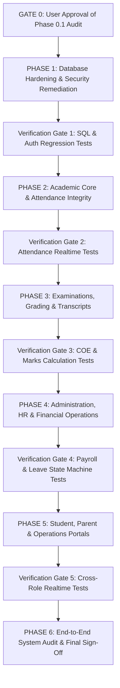

# Updated Phased Implementation Plan (Phase 0.1 Validated)

> **Document Version:** 3.0.0 (Phase 0.1 Technical Remediation Alignment)  
> **Deployment Architecture:** Single-Institution Dedicated Deployment  
> **Target System:** ADHITYAN College Management Software  
> **Status:** PLANNING & SPECIFICATION ONLY (Zero Implementation Executed Without User Approval)

---

## 1. Architectural Strategy & Guiding Principles

1. **Safety & Zero Disruption:** Every database migration must be non-destructive, additive, and preceded by automated pre-condition checks.
2. **Single-Institution Dedicated Architecture:** Complete independence per institution. No cross-college multi-tenancy switches or shared tables.
3. **Database-Enforced Security:** Zero reliance on client-side security checks alone. Every business constraint (roles, attendance deduplication, sensitive columns, leave balances) is enforced at the PostgreSQL database engine layer.
4. **Complete Traceability:** Every task maps directly to cataloged features (`FEAT-001` through `FEAT-118`), verified bugs (`BUG-SEC-001` through `BUG-STR-001`), or operational gaps (`GAP-ADM-001` through `GAP-SPT-001`).
5. **Strict Gatekeeping:** Work on Phase 1 will commence **only after explicit user approval** of this plan and the Phase 0.1 validation reports.

---

## 2. Master Implementation Roadmap

---

## 3. Detailed Phase Breakdown

### Phase 1: Database Hardening & Security Perimeter Remediation
*Objective: Eliminate all P0 and P1 vulnerabilities, establish database-enforced role boundaries, and harden RLS and storage.*

#### Step 1.1: Automated Pre-Migration Verification Gate
- Run automated pre-check script verifying:
  - `class_attendance_sessions` has 0 duplicate rows across `(class_name, session_date, period_number, subject_code)`. (Empirically verified clean).
  - `profiles` table has 0 rows violating the updated 19-role constraint. (Empirically verified clean).
  - Storage bucket `documents` exists and objects table is accessible.

#### Step 1.2: PostgreSQL Migration 028 Execution
Deploy migration `028_phase1_security_and_integrity_hardening.sql`:
1. **Fix `profiles_role_check` (`BUG-ROLE-001`):** Drop and re-add constraint with all 19 roles (`admin, principal, teacher, hod, coe, student, parent, finance_manager, accountant, financier, store_manager, storekeeper, transport_driver, driver, receptionist, naac_coordinator, hr_manager, librarian, hostel_warden, placement_officer`).
2. **Deploy Profile Sensitive Column Protection Trigger (`BUG-SEC-001`):** `trg_protect_profile_columns` preventing non-administrative modification of `role`, `status`, `student_id`, `roll_number`, `login_id`.
3. **Harden Auth Trigger (`BUG-SEC-001`):** Update `handle_new_user()` so `ON CONFLICT DO UPDATE` never syncs `role` or `status` from user metadata.
4. **Attendance Session Unique Constraint (`BUG-ATT-001`):** Add `uq_class_attendance_session` on `(class_name, session_date, period_number, subject_code)`.
5. **Exam Result Auto-Population Trigger (`BUG-EXAM-001`):** Add `trg_set_exam_result_student_name` before insert on `exam_results`.
6. **Staff Leave State Machine Trigger (`BUG-HR-001`):** Add `trg_sync_staff_leave_balance` managing approvals, cancellations, adjustments, and deletions.
7. **Fix Grievance Realtime Trigger (`BUG-CONCERN-001`):** Re-declare `trg_notify_new_concern` referencing `NEW.concern_type`.
8. **Hardening `SECURITY DEFINER` Functions (`BUG-SEC-005`):** Append `SET search_path = public` across all 21 functions.
9. **Hardening `get_admin_overview_stats` RPC (`BUG-SEC-006`):** Add administrative caller verification and revoke public execute.
10. **Granular RLS Policies Replacement (`BUG-RLS-001`):** Replace blanket `USING (true)` policies on all 14 institutional ERP tables.
11. **Hardened Document Storage Deletion (`BUG-SEC-003`):** Restrict `documents` bucket deletions to admins or document owners.

#### Step 1.3: Backend Edge Functions Hardening (`BUG-SEC-004`)
- Update `supabase/functions/admin-create-user/index.ts` to query `public.profiles` with `supabaseAdmin` to verify caller role instead of trusting JWT metadata.
- Update `supabase/functions/admin-users/index.ts` to expand `ALLOWED_ROLES` to all 19 roles and query `public.profiles` for caller authorization.

#### Step 1.4: Client-Side TypeScript & Auth Hardening
- **`AuthContext.tsx` (`BUG-SEC-002`):** Rewrite `mapAuthToUser` to strictly prioritize database `profileData.role`. Remove all string-prefix administrative inferences (`admin*`, `principal*`, `superadmin*`). Assign pending unverified state if profile is missing.
- **`src/config/roles.ts` (`BUG-ROLE-002`):** Correct `naac_coordinator.role` from `'admin'` to `'naac_coordinator'`.
- **`src/types/database.types.ts` (`BUG-ROLE-003`):** Expand `UserRole` union to all 19 institutional roles.

---

### Phase 2: Academic Core & Attendance Integrity
*Objective: Connect teacher roll call, student/parent portals, and attendance shortage alerts into one real-time synchronized workflow.*

- **Teacher Attendance Desk (`FEAT-031`):** Restrict teacher selection to assigned classes/subjects. Connect to database `createClassAttendanceSession`.
- **Accurate Attendance Math (`FEAT-062`, `FEAT-072`):** Enforce standard statutory formula:
  $$\text{Attendance Rate} = \left(\frac{\text{Total Present} + \text{On Duty}}{\text{Total Conducted Sessions}}\right) \times 100$$
  Eliminate dummy 100% initial fallback.
- **Attendance Shortage Warnings (`FEAT-031`, `FEAT-062`):** Automate trigger inserting into `attendance_shortage_warnings` when attendance drops below 75%.
- **Absence Notification Hooks (`FEAT-031`, `FEAT-076`):** Automatically dispatch notifications to students and parents upon marking absent.

---

### Phase 3: Examinations, Grading & Transcripts
*Objective: Unify COE exam creation, timetable publication, hall tickets, teacher marks entry, and student performance cards.*

- **COE Examination Publishing (`FEAT-042`):** Enable publishing controls for exam timetables, hall tickets, and results.
- **Hall Ticket Generation (`FEAT-042`, `FEAT-064`):** Realtime generation with dynamic verification of fee clearance and minimum attendance (75%).
- **Teacher Marks Entry Desk (`FEAT-034`):** Bulk marks entry connected to `exam_results` leveraging auto-population trigger `BUG-EXAM-001`.
- **Academic Performance Metric Separation (`FEAT-063`):**
  - Formal Semester Grade Point Average (SGPA) and Cumulative Grade Point Average (CGPA) calculated strictly on graded academic examinations.
  - CampusPro Student Engagement Index (0–100) calculated on extracurriculars, sports, and attendance.

---

### Phase 4: Administration, HR & Financial Operations
*Objective: Full stack integration of administrative registries, staff leave state machines, payroll, and fee collection.*

- **Staff Leave Manager (`FEAT-087`):** Full UI integration with idempotent state machine trigger (`BUG-HR-001`). Display real-time quota remaining.
- **Statutory Staff Payroll Engine (`FEAT-088`):** Real calculation of Gross Pay, EPF (12% capped), ESI (0.75%), Professional Tax, and Net Disbursed.
- **Institutional Fee Structures & Collection (`FEAT-054`, `FEAT-055`):** Fee installment breakdown, receipt generation with sequential numbering, and income ledger synchronization.
- **Administrative CSV/PDF Exports (`GAP-ADM-001`, `GAP-PRIN-001`):** Replace `window.print()` with structured file downloads.

---

### Phase 5: Student, Parent & Operations Portals
*Objective: Polish operational desks (Store, Transport, Library, Hostel, Reception, Placements).*

- **Campus Store Atomic Orders (`FEAT-057`, `BUG-STR-001`):** Route order placement exclusively through atomic RPC `place_store_order` with zero client-side stock deduction fallbacks.
- **Library Active Loans Enforcment (`FEAT-090`, `BUG-LIB-001`):** Dynamic calculation of active book issues from `book_issues`. Add manual ISBN fallback (`GAP-LIB-001`).
- **Parent Portal Dynamic Child Switching (`FEAT-071`):** Full multi-child switcher pulling live data from `parent_student_links`.
- **Bus Telematics Integration (`FEAT-060`, `GAP-TRN-001`):** Dynamic coordinate polling for vehicle tracking.

---

### Phase 6: Comprehensive End-to-End Audit & Verification
*Objective: Full verification across all 19 roles and 118 features, ensuring 100% operational readiness.*

- Execute automated end-to-end integration test suite (`scripts/test_full_college_workflows_e2e.ts`).
- Verify zero TypeScript compiler warnings or errors (`npx tsc --noEmit`).
- Verify zero PostgreSQL errors or check constraint violations.
- Validate that all 19 role portals render with authentic live database data.
- Deliver Final Phase 1 Completion Audit Report to user.

---

## 4. Phase Verification & Rollback Strategy

| Phase | Success Verification Gate | Rollback Mechanism |
| :---: | :--- | :--- |
| **Phase 1** | Automated test script confirms: role constraint contains 19 roles; non-admin cannot alter role; storage delete restricted; attendance unique key enforced; `tsc --noEmit` clean. | Run `028_rollback.sql` reverting constraints and restoring baseline RLS policies. |
| **Phase 2** | Teacher can only record assigned classes; student attendance percentage matches conducted sessions; realtime updates fire within 500ms. | Git revert on `PeriodAttendanceDesk.tsx` and `StudentAttendanceTab.tsx`. |
| **Phase 3** | Hall tickets reflect fee status; marks entry auto-populates student name without error; results publish to student portal immediately. | Git revert on `ExamDesk.tsx` and `MarksEntryDesk.tsx`. |
| **Phase 4** | Approved leave deducts quota exactly once; cancelled leave restores balance; payroll payslip matches statutory formula. | Git revert on `StaffLeaveManager.tsx` and `PayrollModule.tsx`. |
| **Phase 5** | Store orders execute atomically; student loan limits enforced; child switcher updates child context. | Git revert on `StudentStoreTab.tsx` and `BookIssueDialog.tsx`. |
| **Phase 6** | Full regression test suite passes with 0 failures across all 19 roles. | N/A (Read-only verification pass). |

---

## 5. Execution Pre-Conditions & Next Step

> [!IMPORTANT]
> **Strict Implementation Gate:** No code or database changes will be performed until the user reviews these Phase 0.1 validation deliverables and explicitly approves commencement of **Phase 1 Implementation**.
