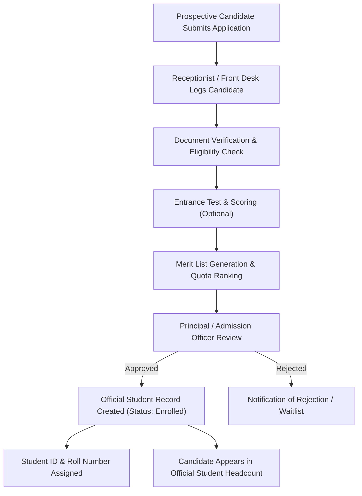
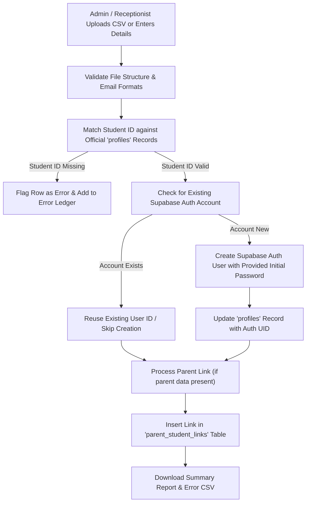
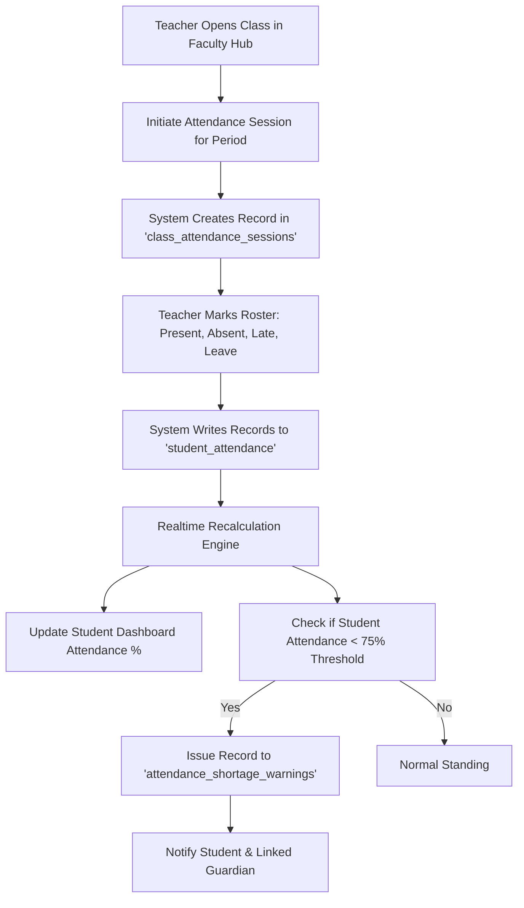
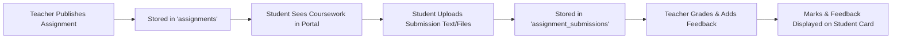
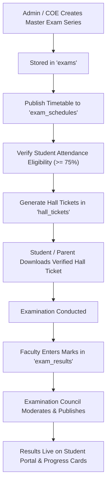
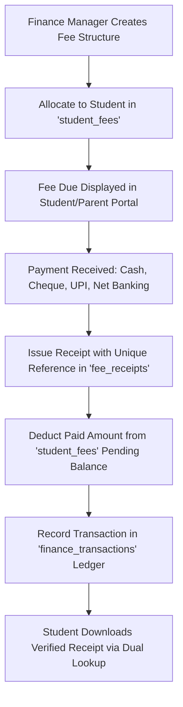
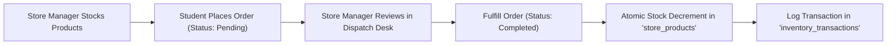
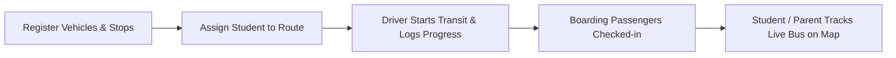
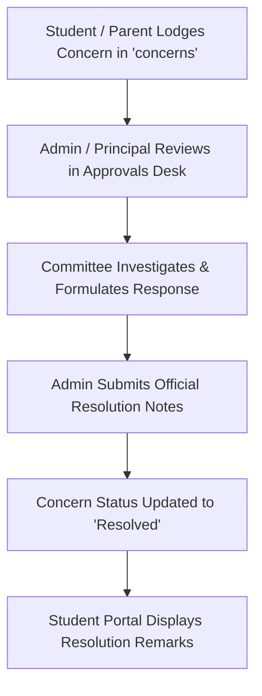

# Complete College Management Software — Workflow Map

> **Document Version:** 2.0.0 (Phase 0 Audit)  
> **Deployment Architecture:** Single-Institution Dedicated Deployment  
> **Purpose:** Detailed step-by-step lifecycle mapping for every institutional process from initiation to completion, specifying acting roles, storage tables, cross-role transitions, and validation gates.

---

## 1. Admission & Student Record Enrollment Workflow

### Steps & State Transitions
1. **Application Intake**: Candidate or Front Desk Receptionist creates entry in `admission_applications` (`status: 'submitted'`). Initial application token/fee recorded in `admission_fees`.
2. **Document Verification**: Admission Officer verifies certificates (10th/12th marksheet, transfer certificate, category certificate) in `admission_document_verifications` (`status: 'verified'`).
3. **Merit List**: Scores ranked in `admission_merit_lists`.
4. **Approval**: Principal or Admin approves application (`status: 'approved'`).
5. **Official Enrollment**: Record committed to `profiles` with official `roll_number` and `class_name`. Student is now part of official institutional statistics.
6. **Independence Invariant**: This step **does not** create a student login account. Login provisioning is an independent administrative process.

---

## 2. Account Provisioning & Student/Parent Linking Workflow

### Steps & State Transitions
1. **File Upload**: Admin uploads Excel/CSV in `AccountProvisioningWorkspace`.
2. **Pre-Validation**: Validates headers (`Student Name`, `Student ID`, `Student Email`, `Initial Password`).
3. **Database Match**: Verifies `Student ID` exists in `profiles`. If not found, row is rejected to prevent orphan accounts.
4. **Account Creation**: Calls backend provisioning service (`adminBackend.ts`) to create Supabase Auth credentials.
5. **Parent Linking**: For parent bulk imports, checks if parent email already exists. If yes, reuses the existing parent account; if no, creates the parent user. Inserts row into `parent_student_links`.
6. **Independence Invariant**: Creating or linking accounts **never** alters the official student admission status or headcount.

---

## 3. Academic Scheduling & Master Timetable Workflow

```mermaid
flowchart LR
    A["Department & Course Creation"] --> B["Faculty Allocation (TeacherAssignments)"]
    B --> C["Section & Classroom Setup"]
    C --> D["Weekly Timetable Period Grid Builder"]
    D --> E["Conflict Detection Engine"]
    E -->|Collision Detected| D
    E -->|Collision Free| F["Publish Timetable to 'timetables'"]
    F --> G["Instant Student & Teacher Schedule Visibility"]
```

### Steps & State Transitions
1. **Curriculum Definition**: Admin sets up departments in `departments` and courses in `courses`.
2. **Faculty Assignment**: Admin/Principal allocates faculty to subjects in `TeacherAssignments`.
3. **Timetable Matrix**: Admin builds weekly schedule in `TimetableManagement`.
4. **Validation Check**: Timetable engine checks for room double-booking and faculty time collisions.
5. **Publish**: Schedule committed to `timetables`. Automatically appears in `TeacherDashboard` and `StudentClassTimetableTab`.

---

## 4. Daily Attendance & Shortage Warning Workflow

### Steps & State Transitions
1. **Conducted Session Creation**: Teacher selects class/period in `PeriodAttendanceDesk`. Inserts row in `class_attendance_sessions` incrementing `total_conducted`.
2. **Student Roster Marking**: Teacher marks each student (`present`, `absent`, `late`, `leave`) writing to `student_attendance`.
3. **Recalculation**: Formula $\left(\frac{\text{Present} + 0.5 \times \text{Late}}{\text{Total Conducted}}\right) \times 100$ runs in `getStudentAttendanceSummary`.
4. **Shortage Warning**: If subject attendance drops below 75%, dynamic warning is triggered in `attendance_shortage_warnings` and alert sent to guardian.

---

## 5. Coursework & Assignment Submission Workflow

### Steps & State Transitions
1. **Assignment Posting**: Teacher enters title, description, max marks, and due date in `CreateAssignment.tsx`. Inserts into `assignments`.
2. **Student View**: Student sees pending tasks in `AssignmentsHomework.tsx`.
3. **Submission**: Student submits work writing to `assignment_submissions` (`status: 'submitted'`).
4. **Evaluation**: Teacher awards marks and feedback in grading desk (`status: 'graded'`).

---

## 6. Examination, Hall Tickets & Result Publishing Workflow

### Steps & State Transitions
1. **Exam Series Creation**: COE/Admin defines semester exams in `exams`.
2. **Schedule Timetable**: Schedules individual subject dates, shifts, and rooms in `exam_schedules`.
3. **Hall Ticket Issuance**: Batch generates numbered hall tickets in `hall_tickets`.
4. **Grading**: Faculty enters theory/practical marks in `GradingInterface.tsx`.
5. **Publishing**: Council clicks publish in `ResultPublishing.tsx`, making grades visible in `StudentExams.tsx` and updating `PerformanceAnalytics`.

---

## 7. Fee Billing, Collection & Receipt Workflow

### Steps & State Transitions
1. **Structure Builder**: Fee packages defined in `fee_structures`.
2. **Allocation**: Student assigned fee record in `student_fees`.
3. **Collection**: Receptionist or Cashier records payment with payment mode and unique transaction reference.
4. **Receipt Generation**: Generated in `fee_receipts` with transaction reference, student ID, and roll number.
5. **Dual Lookup**: Student retrieves receipts via `.or(\`student_id.eq.${id},roll_number.eq.${roll}\`)`.

---

## 8. Campus Store & Inventory Fulfillment Workflow

### Steps & State Transitions
1. **Cataloging**: Products, stock, and prices managed in `store_products`.
2. **Student Order**: Student adds items to cart and submits in `StudentStoreTab.tsx`. Stored in `store_orders` with valid enum `'Pending'`.
3. **Processing**: Store Manager moves order to `'Processing'`, prepares items, then marks `'Completed'`.
4. **Stock Update**: Stock decrements atomically; transaction logged in `inventory_transactions`.

---

## 9. Campus Bus Telematics & Transit Workflow

### Steps & State Transitions
1. **Fleet Management**: Transport Manager adds vehicles in `transport_vehicles` and stops in `transport_stops`.
2. **Route Start**: Driver starts morning transit in `TransportDriverDashboard.tsx`, inserting into `student_transport_logs`.
3. **Tracking**: Students and parents view stop timings, driver phone, and transit status in `TrackSchoolBus.tsx`.

---

## 10. Grievance & Disciplinary Action Workflow

### Steps & State Transitions
1. **Submission**: User submits grievance in `ReportConcern.tsx` or `StudentComplaintsTab.tsx`.
2. **Review**: Administrator reviews complaint in `ApprovalsModule.tsx`.
3. **Resolution**: Official remarks saved to `resolution_notes` and status updated to `'Resolved'`.
4. **Realtime Display**: Resolution notes immediately render in the student's grievance card.
